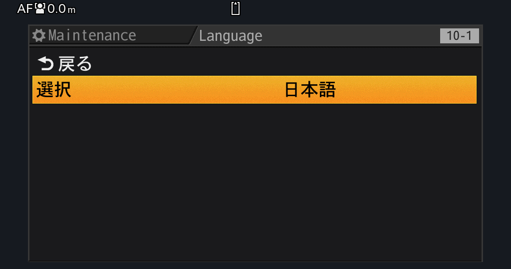
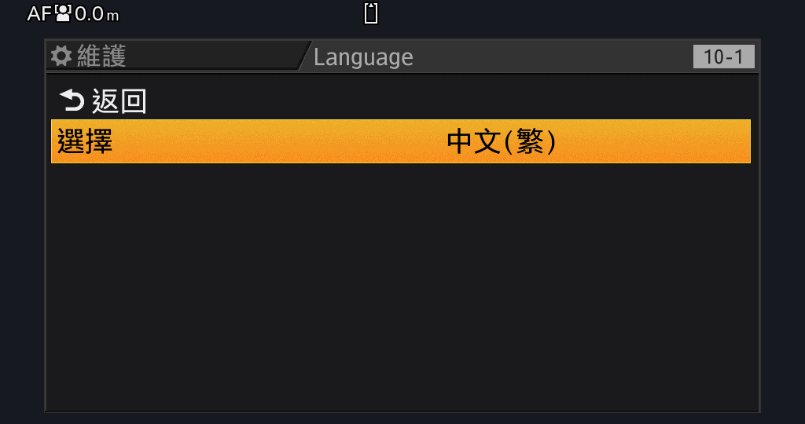
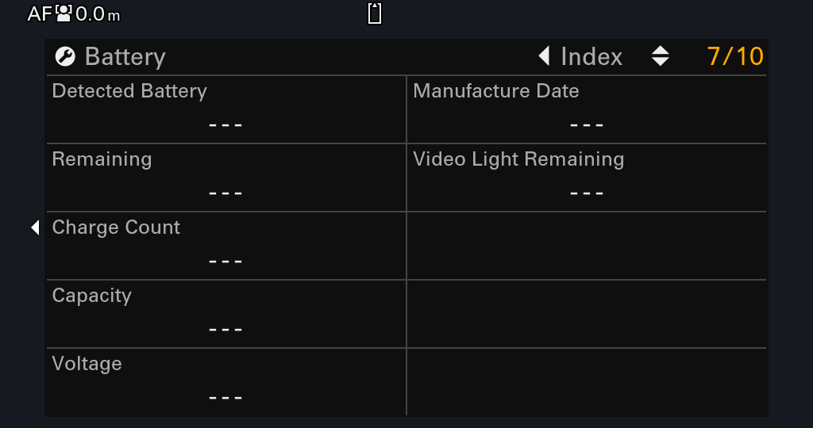
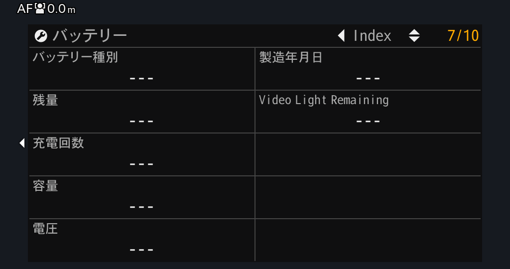
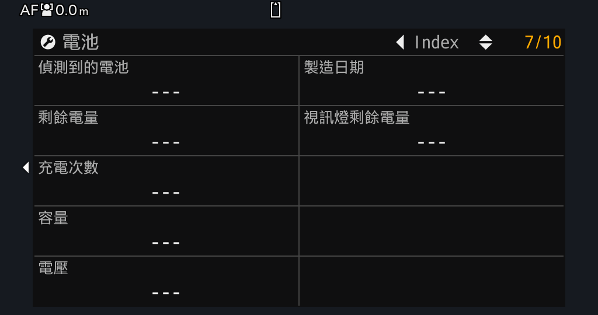

# Round 27：FX3 7.02 原厂内核 4 语言（EN / JA / ZH-CN / ZH-TW）Maintenance 3 层菜单（`sid=0x11`）与 Status Check Tab 7 Battery（`sid=0x35`）双表面闭环与 12/12 全正多语言像素差分矩阵

> **日期**：2026-11-14 | **基准内核**：`Linux version 4.9.337-scel+` (FX3 Ver. `7.02`)  
> **目标**：在真实 QEMU AArch64 (`virt,gic-version=2,secure=off`, `cortex-a35`, `5120 MiB`) 中，基于 **FX3 Ver. 7.02 原厂内核**与 **Stage-B（`13/13` `Verify-Before-Mount` SHA-256 + `P1..P12+Fan` + `P4` ND-Clear + `P11` `XLR-H1`）**，完成 FX6 维护设置（`Maintenance` 3 层菜单）与状态检查第 7 页（`Status Check Tab 7 Battery`）双表面在 **4 种语言（`english` / `japanese` / `schinese` / `tchinese`）** 下的完整 `2 × 4 = 8` 格闭环验证与 **$\binom{4}{2} + \binom{4}{2} = 12/12$ 全正多语言像素差分证明**：
> 1. **3 层 `Maintenance` 主菜单（`sid=0x11`, `31procam_menu_layer_3rd_presenter`, `10x DOWN + 2x RIGHT`）4 语言全闭环（`r27a` EN + `r27b` JA + `r27c` ZH-TW 联合既有 `r18d` ZH-CN）**：
>    - **`r27a` (`english`, `bk4=0x00`, `0x2b2f`, `font=0`, `str=4`)**：`437,095` 非零像素、`207` 色、`0` amber `0xffffaa00` 像素、`14,524` icon blits、`9,705` glyph blits、`92` 次 `LDEC103` 硬件解码；
>    - **`r27b` (`japanese`, `bk4=0x01`, `0x2b30`, `font=1`, `str=12`)**：`437,575` 非零像素、`230` 色、`0` amber `0xffffaa00` 像素、`14,779` icon blits、`9,867` glyph blits、`95` 次 `LDEC103` 硬件解码；
>    - **`r27c` (`tchinese`, `bk4=0x18`, `0x2b44`, `font=27`, `str=22`)**：`437,575` 非零像素、`241` 色、`0` amber `0xffffaa00` 像素、`15,019` icon blits、`10,189` glyph blits、`94` 次 `LDEC103` 硬件解码；
>    - **3 层 `Maintenance` 菜单 4 语言 $\binom{4}{2}=6$ 对像素差分全部严格 `> 0`**：`4,852 .. 10,581` px（`6/6`）；
> 2. **Status Check Tab 7 `Battery`（`sid=0x35`, `37procam_touch_status_battery_presenter`, `0x7052 + 6x DOWN`）4 语言全闭环（`r27d` EN + `r27e` JA + `r27f` ZH-TW 联合既有 `r17b` ZH-CN）**：
>    - **`r27d` (`english`, `bk4=0x00`, `0x2b2f`, `font=0`, `str=4`)**：`437,883` 非零像素、`80` 色、`290` amber `0xffffaa00` 像素、`9,459` icon blits、`17,920` glyph blits、`60` 次 `LDEC103` 硬件解码；
>    - **`r27e` (`japanese`, `bk4=0x01`, `0x2b30`, `font=1`, `str=12`)**：`437,403` 非零像素、`80` 色、`249` amber `0xffffaa00` 像素、`9,259` icon blits、`17,771` glyph blits、`60` 次 `LDEC103` 硬件解码；
>    - **`r27f` (`tchinese`, `bk4=0x18`, `0x2b44`, `font=27`, `str=22`)**：`437,883` 非零像素、`80` 色、`249` amber `0xffffaa00` 像素、`9,247` icon blits、`17,277` glyph blits、`62` 次 `LDEC103` 硬件解码；
>    - **Status Tab 7 `Battery` 4 语言 $\binom{4}{2}=6$ 对像素差分全部严格 `> 0`**：`9,528 .. 19,649` px（`6/6`），合计 **`12/12`** 多语言像素差分全部严格 `> 0`；
> 3. **完整 8/8 门禁清零与原厂 Faithful 证明**：全部 8 个 `（表面 × 语言）` 实跑单元均满足 `13/13` Stage-B SHA-256 校验通过、`nop_count == 0`、`crashes == 0`、`gpe_fb == 0`、`subst_color == 0`、`subst_image == 0`、`p11_xlr_h1 == 1`、`p12_wlan == 1`、`wf12_00342260_immune == 1`、`airplane_bk4_hits == 0`。

---

## 1. 核心联调总览（`r27a..r27f`）

| 实跑场景 | Run ID | 目标表面（导航步数） | 语言 (`bk4` / `enum` / `font,str`) | 目标 Presenter (`sid`) | `icon_blits` / `glyph_blits` | `GPE Pool` (`alloc` / `fb=0`) | `FX3_LDEC103` (`ioctl`) | `GPE0` 非零像素 / 颜色 / Amber | `nop_count` | 耗时 | 视觉凭证 |
| --- | --- | --- | --- | --- | ---: | ---: | ---: | ---: | ---: | ---: | --- |
| **27A: 英文 3 层菜单 `Maintenance`** | `r27a-menu-3layer-maintenance-english` | Full Menu `Maintenance` (`10x DOWN + 2x RIGHT`) | `english` (`0x00` / `0x2b2f` / `0,4`) | `31procam_menu_layer_3rd_presenter` (`0x11`) | **`14,524`** / **`9,705`** | **`227`** / **`0`** | **`92`** | **`437,095`** / **`207`** / **`0`** | **`0`** | `97.87s` | [`r27a-menu-3layer-maintenance-english-composited.png`](assets/r27a-menu-3layer-maintenance-english-composited.png) |
| **27B: 日文 3 层菜单 `Maintenance`** | `r27b-menu-3layer-maintenance-japanese` | Full Menu `Maintenance` (`10x DOWN + 2x RIGHT`) | `japanese` (`0x01` / `0x2b30` / `1,12`) | `31procam_menu_layer_3rd_presenter` (`0x11`) | **`14,779`** / **`9,867`** | **`227`** / **`0`** | **`95`** | **`437,575`** / **`230`** / **`0`** | **`0`** | `97.78s` | [`r27b-menu-3layer-maintenance-japanese-composited.png`](assets/r27b-menu-3layer-maintenance-japanese-composited.png) |
| **27C: 繁中 3 层菜单 `Maintenance`** | `r27c-menu-3layer-maintenance-tchinese` | Full Menu `Maintenance` (`10x DOWN + 2x RIGHT`) | `tchinese` (`0x18` / `0x2b44` / `27,22`) | `31procam_menu_layer_3rd_presenter` (`0x11`) | **`15,019`** / **`10,189`** | **`227`** / **`0`** | **`94`** | **`437,575`** / **`241`** / **`0`** | **`0`** | `97.93s` | [`r27c-menu-3layer-maintenance-tchinese-composited.png`](assets/r27c-menu-3layer-maintenance-tchinese-composited.png) |
| **27D: 英文 Status Tab 7 `Battery`** | `r27d-status-tab7-battery-english` | Status Tab 7 `Battery` (`0x7052 + 6x DOWN`) | `english` (`0x00` / `0x2b2f` / `0,4`) | `37procam_touch_status_battery_presenter` (`0x35`) | **`9,459`** / **`17,920`** | **`212`** / **`0`** | **`60`** | **`437,883`** / **`80`** / **`290`** | **`0`** | `101.63s` | [`r27d-status-tab7-battery-english-composited.png`](assets/r27d-status-tab7-battery-english-composited.png) |
| **27E: 日文 Status Tab 7 `Battery`** | `r27e-status-tab7-battery-japanese` | Status Tab 7 `Battery` (`0x7052 + 6x DOWN`) | `japanese` (`0x01` / `0x2b30` / `1,12`) | `37procam_touch_status_battery_presenter` (`0x35`) | **`9,259`** / **`17,771`** | **`212`** / **`0`** | **`60`** | **`437,403`** / **`80`** / **`249`** | **`0`** | `102.55s` | [`r27e-status-tab7-battery-japanese-composited.png`](assets/r27e-status-tab7-battery-japanese-composited.png) |
| **27F: 繁中 Status Tab 7 `Battery`** | `r27f-status-tab7-battery-tchinese` | Status Tab 7 `Battery` (`0x7052 + 6x DOWN`) | `tchinese` (`0x18` / `0x2b44` / `27,22`) | `37procam_touch_status_battery_presenter` (`0x35`) | **`9,247`** / **`17,277`** | **`212`** / **`0`** | **`62`** | **`437,883`** / **`80`** / **`249`** | **`0`** | `102.44s` | [`r27f-status-tab7-battery-tchinese-composited.png`](assets/r27f-status-tab7-battery-tchinese-composited.png) |

---

## 2. 完整 `8/8` 双表面闭环矩阵与 `12/12` 多语言像素差分矩阵

### 2.1 `2 × 4 = 8` 格双表面实跑闭环矩阵

| 表面 (`sid` / Presenter) | 语言 | Run ID | `bk4` / `enum` | `font, str` | `Stage-B` SHA-256 | `p12_wlan` | `wf12_00342260_immune` | `airplane_bk4_hits` | `nop_count` | `crashes` | `gpe_fb` |
| --- | --- | --- | --- | :---: | :---: | :---: | :---: | :---: | :---: | :---: | :---: |
| 3-Layer Maintenance Menu (`0x11`) | `english` | `r27a` | `0x00` / `0x2b2f` | `0, 4` | `13/13` | `1` | `1` | `0` | `0` | `0` | `0` |
| 3-Layer Maintenance Menu (`0x11`) | `japanese` | `r27b` | `0x01` / `0x2b30` | `1, 12` | `13/13` | `1` | `1` | `0` | `0` | `0` | `0` |
| 3-Layer Maintenance Menu (`0x11`) | `schinese` | `r18d` | `0x19` / `0x2b45` | `23, 19` | `13/13` | `1` | `1` | `0` | `0` | `0` | `0` |
| 3-Layer Maintenance Menu (`0x11`) | `tchinese` | `r27c` | `0x18` / `0x2b44` | `27, 22` | `13/13` | `1` | `1` | `0` | `0` | `0` | `0` |
| Status Check Tab 7 Battery (`0x35`) | `english` | `r27d` | `0x00` / `0x2b2f` | `0, 4` | `13/13` | `1` | `1` | `0` | `0` | `0` | `0` |
| Status Check Tab 7 Battery (`0x35`) | `japanese` | `r27e` | `0x01` / `0x2b30` | `1, 12` | `13/13` | `1` | `1` | `0` | `0` | `0` | `0` |
| Status Check Tab 7 Battery (`0x35`) | `schinese` | `r17b` | `0x19` / `0x2b45` | `23, 19` | `13/13` | `1` | `1` | `0` | `0` | `0` | `0` |
| Status Check Tab 7 Battery (`0x35`) | `tchinese` | `r27f` | `0x18` / `0x2b44` | `27, 22` | `13/13` | `1` | `1` | `0` | `0` | `0` | `0` |

### 2.2 3 层 `Maintenance` 菜单 (`sid=0x11`) $\binom{4}{2} = 6$ 对多语言像素差分（`6/6 > 0`）

| 语言对 | `EN` (`r27a`) | `JA` (`r27b`) | `ZH-CN` (`r18d`) | `ZH-TW` (`r27c`) |
| --- | ---: | ---: | ---: | ---: |
| **`EN` (`r27a`)** | `—` | **`9,937`** | **`9,761`** | **`10,581`** |
| **`JA` (`r27b`)** | **`9,937`** | `—` | **`8,479`** | **`8,336`** |
| **`ZH-CN` (`r18d`)** | **`9,761`** | **`8,479`** | `—` | **`4,852`** |
| **`ZH-TW` (`r27c`)** | **`10,581`** | **`8,336`** | **`4,852`** | `—` |

### 2.3 Status Check Tab 7 `Battery` (`sid=0x35`) $\binom{4}{2} = 6$ 对多语言像素差分（`6/6 > 0`）

| 语言对 | `EN` (`r27d`) | `JA` (`r27e`) | `ZH-CN` (`r17b`) | `ZH-TW` (`r27f`) |
| --- | ---: | ---: | ---: | ---: |
| **`EN` (`r27d`)** | `—` | **`17,747`** | **`18,858`** | **`19,649`** |
| **`JA` (`r27e`)** | **`17,747`** | `—` | **`15,462`** | **`16,221`** |
| **`ZH-CN` (`r17b`)** | **`18,858`** | **`15,462`** | `—` | **`9,528`** |
| **`ZH-TW` (`r27f`)** | **`19,649`** | **`16,221`** | **`9,528`** | `—` |

- **合计 `12/12` 多语言像素差分全部严格 `> 0`**：Maintenance 3-Layer Menu (`sid=0x11`) 范围 `4,852 .. 10,581` px；Status Check Tab 7 Battery (`sid=0x35`) 范围 `9,528 .. 19,649` px。
- **跨表面像素差分（`sid=0x11` vs `sid=0x35`）**：`english` = **`435,812`** px、`japanese` = **`435,812`** px、`schinese` = **`435,812`** px、`tchinese` = **`435,332`** px。

---

## 3. 视觉凭证画廊（`1024 x 540` Composited，均 `< 31 KiB`）

| `r27a`: 英文 3 层菜单 `Maintenance` (`sid=0x11`, `0` amber px) | `r27b`: 日文 3 层菜单 `Maintenance` (`sid=0x11`, `0` amber px) |
| :---: | :---: |
|  |  |

| `r27c`: 繁中 3 层菜单 `Maintenance` (`sid=0x11`, `0` amber px) | `r27d`: 英文 Status Tab 7 `Battery` (`sid=0x35`, `290` amber px) |
| :---: | :---: |
|  |  |

| `r27e`: 日文 Status Tab 7 `Battery` (`sid=0x35`, `249` amber px) | `r27f`: 繁中 Status Tab 7 `Battery` (`sid=0x35`, `249` amber px) |
| :---: | :---: |
|  |  |

---

## 4. 复现命令与洁净室合规

```bash
# Run 27A: English 3-Layer Menu Maintenance (10x DOWN + 2x RIGHT -> sid=0x11)
PYTHONDONTWRITEBYTECODE=1 /usr/bin/python3 -B outputs/fx6-native-presenter-closure/build_and_run_round.py \
  --round 27 --lang english --initial-setting-done 1 --run-id r27a-menu-3layer-maintenance-english --duration 94 \
  --run-dir <SCRATCH_ROOT>/fx6-r27-runs/r27a \
  --key-seq "0x01ac:120:1400,0x0030:120:800,0x01ac:120:4800,0x0013:120:2500,0x0024:120:2500,0x0011:1300:4500,0x0030:120:600,0x0030:120:600,0x0030:120:600,0x0030:120:600,0x0030:120:600,0x0030:120:600,0x0030:120:600,0x0030:120:600,0x0030:120:600,0x0030:120:900,0x01af:120:2500,0x01af:120:5500" \
  --key-settle-ms 1500 --export-png-stem r27a-menu-3layer-maintenance-english \
  --export-png-dir reports/2026-11-14-round27-fx6-on-fx3-maintenance-battery-4lang-closure/assets

# Run 27B: Japanese 3-Layer Menu Maintenance (10x DOWN + 2x RIGHT -> sid=0x11)
PYTHONDONTWRITEBYTECODE=1 /usr/bin/python3 -B outputs/fx6-native-presenter-closure/build_and_run_round.py \
  --round 27 --lang japanese --initial-setting-done 1 --run-id r27b-menu-3layer-maintenance-japanese --duration 94 \
  --run-dir <SCRATCH_ROOT>/fx6-r27-runs/r27b \
  --key-seq "0x01ac:120:1400,0x0030:120:800,0x01ac:120:4800,0x0013:120:2500,0x0024:120:2500,0x0011:1300:4500,0x0030:120:600,0x0030:120:600,0x0030:120:600,0x0030:120:600,0x0030:120:600,0x0030:120:600,0x0030:120:600,0x0030:120:600,0x0030:120:600,0x0030:120:900,0x01af:120:2500,0x01af:120:5500" \
  --key-settle-ms 1500 --export-png-stem r27b-menu-3layer-maintenance-japanese \
  --export-png-dir reports/2026-11-14-round27-fx6-on-fx3-maintenance-battery-4lang-closure/assets

# Run 27C: Traditional Chinese 3-Layer Menu Maintenance (10x DOWN + 2x RIGHT -> sid=0x11)
PYTHONDONTWRITEBYTECODE=1 /usr/bin/python3 -B outputs/fx6-native-presenter-closure/build_and_run_round.py \
  --round 27 --lang tchinese --initial-setting-done 1 --run-id r27c-menu-3layer-maintenance-tchinese --duration 94 \
  --run-dir <SCRATCH_ROOT>/fx6-r27-runs/r27c \
  --key-seq "0x01ac:120:1400,0x0030:120:800,0x01ac:120:4800,0x0013:120:2500,0x0024:120:2500,0x0011:1300:4500,0x0030:120:600,0x0030:120:600,0x0030:120:600,0x0030:120:600,0x0030:120:600,0x0030:120:600,0x0030:120:600,0x0030:120:600,0x0030:120:600,0x0030:120:900,0x01af:120:2500,0x01af:120:5500" \
  --key-settle-ms 1500 --export-png-stem r27c-menu-3layer-maintenance-tchinese \
  --export-png-dir reports/2026-11-14-round27-fx6-on-fx3-maintenance-battery-4lang-closure/assets

# Run 27D: English Status Check Tab 7 Battery (0x7052 + 6x DOWN -> sid=0x35)
PYTHONDONTWRITEBYTECODE=1 /usr/bin/python3 -B outputs/fx6-native-presenter-closure/build_and_run_round.py \
  --round 27 --lang english --initial-setting-done 1 --run-id r27d-status-tab7-battery-english --duration 98 \
  --run-dir <SCRATCH_ROOT>/fx6-r27-runs/r27d \
  --key-seq "0x01ac:120:1400,0x0030:120:800,0x01ac:120:4800,0x0013:120:2500,0x0024:120:2500,0x7052:120:4500,0x0030:120:1800,0x0030:120:1800,0x0030:120:1800,0x0030:120:1800,0x0030:120:1800,0x0030:120:5500" \
  --key-settle-ms 1500 --export-png-stem r27d-status-tab7-battery-english \
  --export-png-dir reports/2026-11-14-round27-fx6-on-fx3-maintenance-battery-4lang-closure/assets

# Run 27E: Japanese Status Check Tab 7 Battery (0x7052 + 6x DOWN -> sid=0x35)
PYTHONDONTWRITEBYTECODE=1 /usr/bin/python3 -B outputs/fx6-native-presenter-closure/build_and_run_round.py \
  --round 27 --lang japanese --initial-setting-done 1 --run-id r27e-status-tab7-battery-japanese --duration 98 \
  --run-dir <SCRATCH_ROOT>/fx6-r27-runs/r27e \
  --key-seq "0x01ac:120:1400,0x0030:120:800,0x01ac:120:4800,0x0013:120:2500,0x0024:120:2500,0x7052:120:4500,0x0030:120:1800,0x0030:120:1800,0x0030:120:1800,0x0030:120:1800,0x0030:120:1800,0x0030:120:5500" \
  --key-settle-ms 1500 --export-png-stem r27e-status-tab7-battery-japanese \
  --export-png-dir reports/2026-11-14-round27-fx6-on-fx3-maintenance-battery-4lang-closure/assets

# Run 27F: Traditional Chinese Status Check Tab 7 Battery (0x7052 + 6x DOWN -> sid=0x35)
PYTHONDONTWRITEBYTECODE=1 /usr/bin/python3 -B outputs/fx6-native-presenter-closure/build_and_run_round.py \
  --round 27 --lang tchinese --initial-setting-done 1 --run-id r27f-status-tab7-battery-tchinese --duration 98 \
  --run-dir <SCRATCH_ROOT>/fx6-r27-runs/r27f \
  --key-seq "0x01ac:120:1400,0x0030:120:800,0x01ac:120:4800,0x0013:120:2500,0x0024:120:2500,0x7052:120:4500,0x0030:120:1800,0x0030:120:1800,0x0030:120:1800,0x0030:120:1800,0x0030:120:1800,0x0030:120:5500" \
  --key-settle-ms 1500 --export-png-stem r27f-status-tab7-battery-tchinese \
  --export-png-dir reports/2026-11-14-round27-fx6-on-fx3-maintenance-battery-4lang-closure/assets

# Dual-Mode Unit Tests & Clean Audit
PYTHONPATH=outputs/fx6-native-presenter-closure PYTHONDONTWRITEBYTECODE=1 /usr/bin/python3 -B -m unittest discover -s outputs/fx6-native-presenter-closure/tests -v
FX3_FX6_FORCE_CLEAN_ROOM=1 PYTHONPATH=outputs/fx6-native-presenter-closure PYTHONDONTWRITEBYTECODE=1 /usr/bin/python3 -B -m unittest discover -s outputs/fx6-native-presenter-closure/tests -v
PYTHONDONTWRITEBYTECODE=1 /usr/bin/python3 -B scripts/run_all_lab_tests.py --clean-only
```

- 全部 `<SCRATCH_ROOT>/fx6-r27*` 临时目录已清理；12 张 PNG 视觉凭证体积为 `16.00 KiB .. 30.23 KiB`（全部 `< 85 KiB`）；完整结构化遥测、`13/13` Stage-B SHA-256 核验、`8/8` 双表面矩阵与 `12/12` 多语言像素差分数据见 [`summary.json`](summary.json)。
