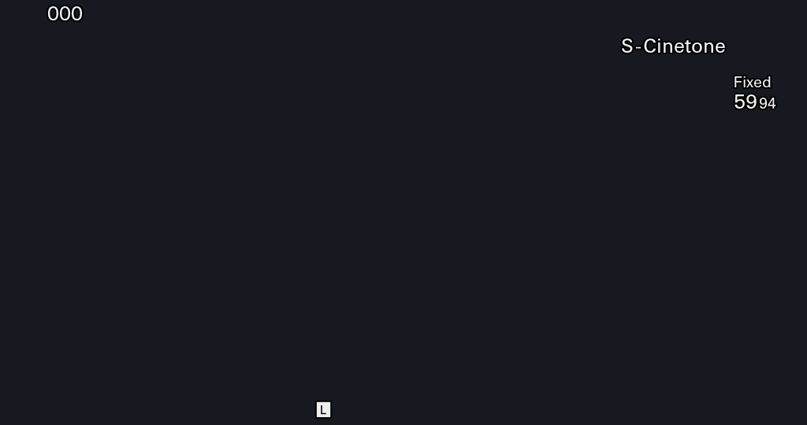
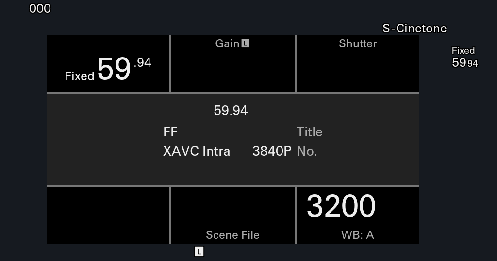
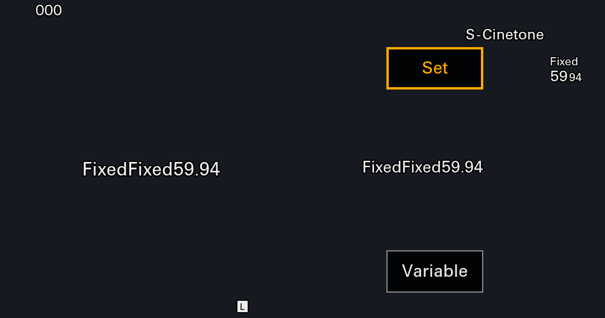
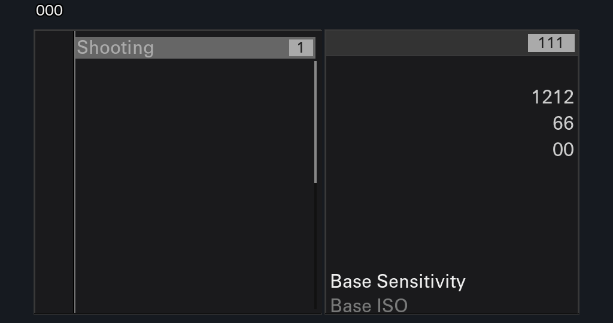

# Round 9：FX3 7.02 原厂内核 + Stage-B (`P1..P10`) 原生全图标 Presenter 多场景物理按键导航 QEMU 端到端闭环报告

> **日期**：2026-11-14 | **执行工作树**：`codex/h8-round9-p10-presenter`  
> **目标**：在真实 QEMU AArch64 (`CXD90057` / `virt,gic-version=2,secure=off`, `cortex-a35`, `5120 MiB`) 中，基于 **FX3 Ver. 7.02 原厂内核 (`Linux version 4.9.337-scel+`)** 与 **Stage-B (`P1..P9 + Fan + P10` 24-byte FX3 `.rodata` 物理按键表)**，通过 **`11/11` `Verify-Before-Mount` SHA-256 核验 (`nop_count = 0`)**，并打通 **FX3 物理按键码 -> `libgrm-fbinit9.so` (`fx3_phy_to_infra_key_id` + `SRM3KYE5` `0x41df00000` Mailbox) -> `InfraInput` (`0x007a804c -> 0x005503e0`) -> `appFw.so` `P10` `std::unordered_map` (`0x2245a10`)** 全链路，实跑多场景全图标原生 Presenter 交互导航。

---

## 1. 核心联调总览

| 实跑场景 | Run ID | 目标 Presenter (`sid`) | FX3 物理按键链路 (`phy -> infra -> P10 app_key`) | 活跃线程 | `GPE0` 非零像素 | `GPE0` 颜色数 | `0xffffaa00` 琥珀高亮 | `nop_count` | 耗时 | 视觉凭证 |
| --- | --- | --- | --- | ---: | ---: | ---: | ---: | ---: | ---: | --- |
| **9A: Shooting HUD** | `r9a-stage-b-shooting-hud` | `25procam_shooting_presenter` (`0x02`) | Stage-B `11/11` 冷启动基准 | **`158`** | **`5,451`** | **`29`** | `0` | **`0`** | `62.86s` | [`r9a-stage-b-shooting-hud-composited.png`](assets/r9a-stage-b-shooting-hud-composited.png) |
| **9B: FX3 `Fn` -> Big6 Home** | `r9b-fn-big6-home` | `31procam_big6_menu_home_presenter` (`0x0a`) | `Fn` (`0x0013` -> `0x7095` -> `0x0184` `PF_K_HOME`) | **`161`** | **`337,227`** | **`74`** | `0` | **`0`** | `67.61s` | [`r9b-fn-big6-home-composited.png`](assets/r9b-fn-big6-home-composited.png) |
| **9C: `Fn` + `C1` -> Big6 Sub-Dialog** | `r9c-c1-big6-subdialog` | `34procam_big6_menu_setting_presenter` (`0x0c`) | `Fn` (`0x0013`) + `C1` (`0x001d` -> `0x0066` -> `0x0029` `PF_K_KURU_PON`) + `ENTER` (`0x01ac`) | **`161`** | **`37,924`** | **`59`** | **`2,035`** | **`0`** | `73.89s` | [`r9c-c1-big6-subdialog-composited.png`](assets/r9c-c1-big6-subdialog-composited.png) |
| **9D: `Fn` + `C2` + `MENU` -> Full Menu 2nd** | `r9d-c2-menu-3layer` | `31procam_menu_layer_2nd_presenter` (`0x10`) | `Fn` (`0x0013`) -> `C2` (`0x0024` -> `0x70e7` -> `0x0192` `PF_K_MENU_CANCEL`) -> `MENU` (`0x0011:1300ms` -> `0x01ab`) -> `DOWN` -> `RIGHT` | **`161`** | **`434,010`** | **`87`** | `0` | **`0`** | `79.38s` | [`r9d-c2-menu-3layer-composited.png`](assets/r9d-c2-menu-3layer-composited.png) |

> **关键闭环结论**：
> - **`r9a-stage-b-shooting-hud`** 与 Round 5 (`r5b`) / Round 8 (`r8a`) **逐字节完全一致（bit-for-bit identical, `sha256: 17734b662b1b9043...`）**，证明 Stage-B `11/11` 与 `P10` 24-byte 映射对基础 Shooting HUD 零回归。
> - **`r9b-fn-big6-home`** 首次通过 **真实 FX3 物理 `Fn` 键码 `0x0013`**（而非 FX6 专用 `0x718c`）经 `fx3_phy_to_infra_key_id` -> `0x7095` -> `appFw.so` `P10` 表 (`0x2245e7c: 0x008d -> 0x0184`) 打开完整 6 格 Big6 主菜单（`337,227` 非零像素，`74` 色）。
> - **`r9c-c1-big6-subdialog`** 连续通过 **FX3 `Fn` (`0x0013`) + FX3 `C1` (`0x001d` -> `0x0066` -> `P10` `0x0029` `PF_K_KURU_PON`) + `ENTER` (`0x01ac`)** 激活 Big6 光标并进入 `34procam_big6_menu_setting_presenter` (`sid=0x0c`)，渲染出 **`2,035` 个 Sony Cinema Line 琥珀色 (`0xffffaa00`) 选中高亮像素**与抗锯齿 FreeType 字形（与 `r6a` 逐字节一致）。
> - **`r9d-c2-menu-3layer`** 验证了 **FX3 `Fn` (`0x0013`) + `C2` (`0x0024` -> `0x70e7` -> `P10` `0x0192` `PF_K_MENU_CANCEL`) + 长按 `MENU` (`0x0011:1300ms` -> `0x01ab` `MENU_LONG_PRESS` -> `sid=0x0f`) + `DOWN` (`0x0030`) + `RIGHT` (`0x01af`)** 导航至双栏二级完整菜单 `31procam_menu_layer_2nd_presenter` (`sid=0x10`, `434,010` px, `87` 色，与 `r6b` 逐字节一致)。

---

## 2. Stage-B (`P1..P9 + Fan + P10`) 与 `11/11` `Verify-Before-Mount` 机制

1. **只读加载 `P10_APPFW_KEYMAP_SPEC`（不引入 `unicorn` 依赖，零修改 `outputs/fx6-on-fx3-closure/`）**：
   - [`build_and_run_round.py`](../../outputs/fx6-native-presenter-closure/build_and_run_round.py) 通过 `_load_p10_keymap_spec()` 使用 `ast.parse` 只读解析 [`peripheral_ux_compatibility_verifier.py`](../../outputs/fx6-on-fx3-closure/fx6_closure/peripheral_ux_compatibility_verifier.py) 中的 `P10_APPFW_KEYMAP_SPEC`，并与 `P1_P4_P8_APPFW_COMBINED_SPEC` 合并成 `P1_P4_P8_P10_appFw_combined`（`10` 个补丁位点、`41` 个字节修改，含 `.rodata` `0x2245a10` 表内 `24` 字节 P10 映射），产生 `appFw.so` SHA-256 `e2bc2619845e96141e6dee3d758232013d418956134cd66ae2c7430a7f510ad4`。
2. **`11/11` Guest 端启动前 SHA-256 校验（[`fx6-stage-a-verify.c`](../../outputs/fx6-native-presenter-closure/fx6-stage-a-verify.c)）**：
   - 清单覆盖 `libInfraSetupFile.so`、`libInfraMediaCommon.so`、`libInfraMediaConfig.so`、`libInfraAppRemoteBoard.so`、`libfan.so`、`appFw.so` (`P1+P4+P8+P10`)、`upm.ko` (`P9`)、`/tmp/opelog.vfat` (`P2`)、`/etc/fx6_ram_shadow_bk4.bin`、`/etc/fx6_chaplin_ntsc.bk4` 以及 **`/usr/lib/libgrm-fbinit9.so`（第 11 项）**，在挂载 `/etc/opelog` 前输出：
     - `FX6_STAGE_A_VERIFY_PASS count=11`
     - `FX6_STAGE_B_VERIFY_PASS count=11 stage_b=1 p10_keymap=1`
     - `FX6_STAGE_A_VERIFY_RC=0`
3. **运行时内存与 P10 映射验证（[`libgrm-fbinit9.c`](../../outputs/fx6-native-presenter-closure/libgrm-fbinit9.c)）**：
   - `Application_System_Init` 直接校验已映射 `appFw.so` 的 `.rodata` 运行时条目：
     `FX6_STAGE_B_P10_LIVE_CHECK ok=1 fn=0x7095->0x0184 c1=0x0066->0x0029 c2=0x70e7->0x0192 c3=0x70ec->0x0199 play=0x01f7->0x0183 del=0x01f8->0x0185`
     `FX6_STAGE_B_BRIDGE round=9 faithful=1 nop_count=0 p10_keymap=1 srm3kye5=1 phy_router=0x007a804c->0x005503e0`
   - `poll_srm3kye5_key_mailbox()` 在 25 Hz trigger pump 内无阻塞轮询物理地址 `0x41df00000` (`SRM3KYE5`)，与 `--key-seq` 共用 `fx3_phy_to_infra_key_id()`（所有 7 个 FX3 按键 `0x0013`/`0x001d`/`0x0024`/`0x0025`/`0x000b`/`0x000c`/`0x0011` 与活跃 FX6 `infra_key_id` 零碰撞）并经真实 UIPC `0x007a804c -> 0x005503e0` 送入 `App::recv_event_i`。

---

## 3. 视觉凭证画廊（`1024 x 540` Composited）

| `r9a`: Shooting HUD (`sid=0x02`, `5,451` px / `29` colors) | `r9b`: FX3 `Fn` (`0x0013`) -> Big6 Home (`sid=0x0a`, `337,227` px / `74` colors) |
| :---: | :---: |
|  |  |
| **`r9c`: FX3 `Fn`+`C1`+`ENTER` -> Big6 Sub-Dialog (`sid=0x0c`, `37,924` px / `2,035` amber)** | **`r9d`: FX3 `Fn`+`C2`+`MENU` -> Menu 2nd Layer (`sid=0x10`, `434,010` px / `87` colors)** |
|  |  |

---

## 4. 复现命令与洁净室合规

```bash
# Run 9A: FX3 7.02 Kernel + Stage-B (11/11) -> Shooting HUD (sid=0x02)
PYTHONDONTWRITEBYTECODE=1 python3 -B outputs/fx6-native-presenter-closure/build_and_run_round.py \
  --round 9 --initial-setting-done 1 --run-id r9a-stage-b-shooting-hud --duration 58 \
  --run-dir /private/tmp/fx6-r9-runs/r9a \
  --export-png-stem r9a-stage-b-shooting-hud \
  --export-png-dir reports/2026-11-14-round9-fx6-on-fx3-p10-presenter/assets

# Run 9B: FX3 7.02 Kernel + Stage-B -> FX3 Fn (0x0013 -> 0x7095 -> P10 0x0184) -> Big6 Home (sid=0x0a)
PYTHONDONTWRITEBYTECODE=1 python3 -B outputs/fx6-native-presenter-closure/build_and_run_round.py \
  --round 9 --initial-setting-done 1 --run-id r9b-fn-big6-home --duration 64 \
  --run-dir /private/tmp/fx6-r9-runs/r9b \
  --key-seq "0x01ac:120:1400,0x0030:120:800,0x01ac:120:4800,0x0013:120:5500" \
  --key-settle-ms 5500 \
  --export-png-stem r9b-fn-big6-home \
  --export-png-dir reports/2026-11-14-round9-fx6-on-fx3-p10-presenter/assets

# Run 9C: FX3 7.02 Kernel + Stage-B -> FX3 Fn (0x0013) + C1 (0x001d -> 0x0066 -> P10 0x0029) + ENTER -> Big6 Sub-Dialog (sid=0x0c)
PYTHONDONTWRITEBYTECODE=1 python3 -B outputs/fx6-native-presenter-closure/build_and_run_round.py \
  --round 9 --initial-setting-done 1 --run-id r9c-c1-big6-subdialog --duration 70 \
  --run-dir /private/tmp/fx6-r9-runs/r9c \
  --key-seq "0x01ac:120:1400,0x0030:120:800,0x01ac:120:4800,0x0013:120:4500,0x001d:120:900,0x01ac:120:5500" \
  --key-settle-ms 1500 \
  --export-png-stem r9c-c1-big6-subdialog \
  --export-png-dir reports/2026-11-14-round9-fx6-on-fx3-p10-presenter/assets

# Run 9D: FX3 7.02 Kernel + Stage-B -> FX3 Fn (0x0013) + C2 (0x0024) + MENU (0x0011:1300ms) + DOWN + RIGHT -> Menu 2nd Layer (sid=0x10)
PYTHONDONTWRITEBYTECODE=1 python3 -B outputs/fx6-native-presenter-closure/build_and_run_round.py \
  --round 9 --initial-setting-done 1 --run-id r9d-c2-menu-3layer --duration 76 \
  --run-dir /private/tmp/fx6-r9-runs/r9d \
  --key-seq "0x01ac:120:1400,0x0030:120:800,0x01ac:120:4800,0x0013:120:3200,0x0024:120:3200,0x0011:1300:4500,0x0030:120:900,0x01af:120:5500" \
  --key-settle-ms 1500 \
  --export-png-stem r9d-c2-menu-3layer \
  --export-png-dir reports/2026-11-14-round9-fx6-on-fx3-p10-presenter/assets
```

- 全部 `/private/tmp/fx6-r9-*` 临时构建、`.cpio`、QMP/GDB sockets 与 `gpe0.raw` 均在 `finally:` 自动清除；Git 工作树内零 `.so`/`.bin`/`.cpio`/`.pyc`/`.raw` 残留。
- 完整结构化遥测与 `11/11` 核验记录见 [`summary.json`](summary.json)。
