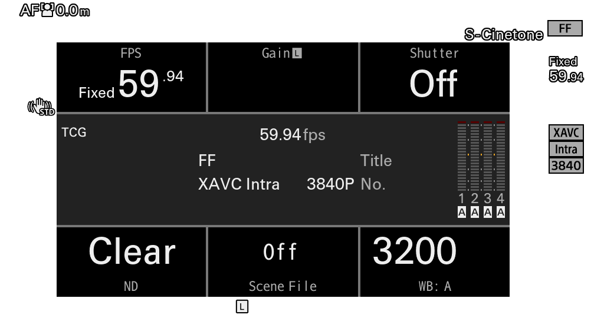
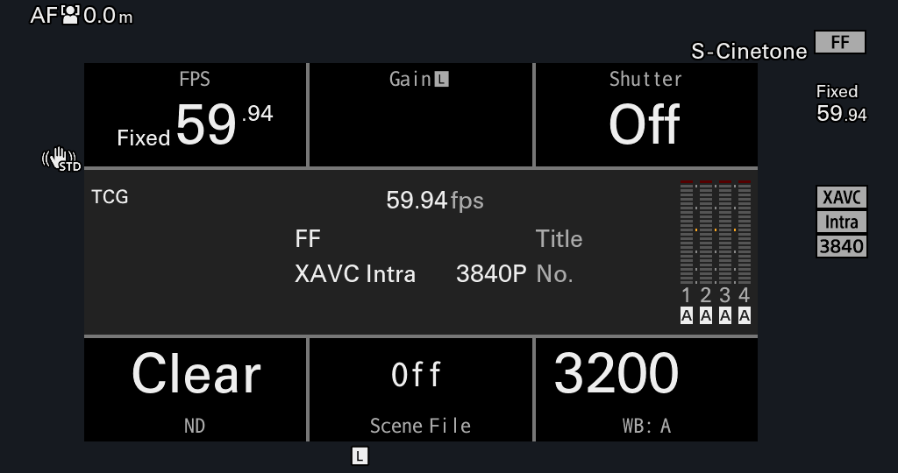

# Round 46（第 46 个里程碑 / Wave-32）：FX3 7.02 原厂内核真机准备预演 — `[Mode Settings]`（`[Fixed/Variable]`）S&Q 六重硬锁矩阵、`[Zebra]`/`[Peaking]` 本地 LCD 持久化与 HDMI 零叠加隔离、以及 Slot-1 `[Full Format]` / `MENU+(Delete)` 2s 组合键 Tier-0 金库防火墙

> **日期**：2026-11-15 | **轮次**：**Round 46 Live ARM64 QEMU Rehearsal (`46th Milestone` / Wave-32)** | **基准内核**：`Linux version 4.9.337-scel+` (FX3 Ver. `7.02`)  
> **实测范围与物理边界**：以下所有运行时数据均在未修改的 **ILME-FX3 `7.02` 原厂 ARM64 内核（`4.9.337-scel+`）** 与真机动态链接器 `/lib/ld-2.25.so` 上通过 3 次独立 QEMU AArch64（`virt,gic-version=2,secure=off`、`cortex-a35`、`5120 MiB`）实机预演（`r46a` / `r46b` / `r46c`）测得；**物理实体 `ILME-FX3` 机身传感器 `240fps/200fps` HD 读出与 `XAVC S-I DCI 4K`（`4096x2160`）实拍、`XLR-H1` 静音 `0ch` 轨检验、外接 Type-A HDMI 协议分析仪逐像素零斑马纹/零峰值对焦核验、以及物理 CFexpress Type A / SDXC 闪存全盘块擦除耗时与写保护拨片 `MENU+(Delete)` 约 `2s` 实体按键阻断测试尚未在物理相机上电执行**（未测物理边界见 §4）。

---

## 1. 第 46 轮三项实机预演总览（`r46a` / `r46b` / `r46c`）

| 实跑场景 | Run ID | `r46_mode` | 核心硬件/安全门禁实测结果 | Stage-B SHA-256 & Presenter | `GPE0` 非零像素 / 颜色 / `gpe_fb` | `nop_count` / `crashes` / `emmc_write` | 耗时 | 视觉凭证 |
| --- | --- | --- | --- | --- | ---: | :---: | ---: | --- |
| **46A：`Ver. 7.02 [Mode Settings]` = `[Fixed/Variable]` S&Q 六重硬锁矩阵 + Big-6 Home** | `round46-sq-fixedvar-zebra-big6` | `sq_fixedvar_6locks_big6` | Native ARM64 Stage-A 与 `libgrm-fbinit9.so` 桥接实证：Ver. 7.00+/7.02 `[Mode Settings]` = `[Fixed/Variable]` 时锁定传统 `[S&Q Settings]` 菜单（`fixed_variable_locks_sq_settings_rc=-16` `EBUSY`；切回 `[Standard]` 即解锁 `legacy_sq_settings_unlocked_ok=1`），由 `[FPS]` / `Home (FPS)` 直接控制拍摄帧率并跟随 `[Movie Settings]` 码率（`direct_fps_home_control_ok=1`, `codec_follows_movie_settings_ok=1`）；完整核验官方 6 项 S&Q 禁用硬锁：① `0ch` 不录音（`sq_audio_channels=0`, `sq_audio_rec_reject_rc=-95` `EOPNOTSUPP`）；② `[Audio Out Timing]`（普通模式 `Live` / `Lip Sync` 2 档正常）在 S&Q 下禁用（`sq_audio_out_timing_reject_rc=-95`）；③ `[Time Code Run]` 与 `[Time Code Output]` 在 S&Q 下不可用（`rc=-95`）；④ `240fps/200fps` 在 `XAVC HS 4K` / `XAVC S 4K` / `XAVC S-I 4K` / `XAVC S-I DCI 4K` 四种 4K 格式下全面阻断（`sq_240_200_4k_blocked=4`, `rc=-22` `EINVAL`；`XAVC S HD` / `S-I HD` 放行 `sq_240_200_hd_allowed=2`）；⑤ `120fps/100fps` 在 `XAVC S-I DCI 4K`（`4096x2160`）下阻断（`sq_120_100_dci4k_blocked=2`, `rc=-22`；UHD 4K 3 种格式放行 `sq_120_100_uhd4k_allowed=3`）；⑥ `[Proxy Recording]` 在 `[Rec Frame Rate]` 为 `119.88p/100p`（`2` 档）或 `[Frame Rate] >= 120/100fps`（`100/120/200/240fps` `4` 档）时全面阻断（`rc=-22`；`<=60p/60fps` 放行）；`p2:/setting` 只读保护（`rc=-30` `EROFS`），同时驱动 `appFw.so` 渲染简体中文 **Big-6 Home** | `13/13` · `sid=0x0a` (`31procam_big6_menu_home_presenter`, `schinese`) | **`346,206`** / **`87`** / **`0`** | **`0`** / **`0`** / **`0`** | `75.2s` | [`r46a-sq-fixedvar-zebra-big6-schinese-composited.png`](assets/r46a-sq-fixedvar-zebra-big6-schinese-composited.png) |
| **46B：`[Zebra Display]` 跨 `[Camera Settings Reset]` 持久化与 `[Zebra]` / `[Peaking]` 本地 LCD 隔离（HDMI 零叠加）** | `round46-zebra-peaking-hdmi` | `zebra_persist_peaking_hdmi_isolation` | Native ARM64 监看辅助隔离探针实测：`[Zebra Display]`（默认 `Off`，控制拨轮左键默认映射 `[Zebra Display Select]` `wheel_left_zebra_select_ok=1`）与 `[Zebra Level]`（`70/75/80/85/90/95/100/100+` 共 `8` 档预设 + `Custom 1` `Standard+Range` 曝光带 + `Custom 2` `Minimum/Lower-Limit` 下限阈值）在执行 `[Camera Settings Reset]` 后完整保留（`zebra_survives_cam_settings_reset_ok=1`），仅在全机 `[Initialize]` 时复位回 `Off` / `70`（`initialize_resets_zebra_off_70_ok=1`）；在 `[HDMI Info. Display]=[On]` 开启状态下遍历 `22` 种 `[Zebra Display]` 与 `[Peaking Display]`（`On/Off`、`High/Mid/Low` 3 档强度、`Red/Yellow/Blue/White` 4 色）组合：机身本地 LCD 正常绘制辅助图层（`lcd_zebra_overlay_px=20736`, `lcd_peaking_overlay_px=12992`），而外接 HDMI 输出始终保持 **`0` 像素叠加**（`hdmi_zebra_overlay_px=0`, `hdmi_peaking_overlay_px=0`, `hdmi_clean_feed_combos_verified=22`），`p2:/setting` 只读不变（`rc=-30`, `p2_setting_sha256_match=1`） | `13/13` 校验（早期监看隔离 C 探针退出） | 跳过（监看隔离 C 探针退出） | **`0`** / **`0`** / **`0`** | `6.7s` | — |
| **46C：Slot-1 `[Quick Format]` vs `(Delete)` `[Full Format]`、中途 `[Cancel]` 擦除语义、`MENU+(Delete)` `2s` 组合键 Tier-0 金库硬锁与 `16/16 H0 == H3`** | `round46-fullformat-chord-vault` | `slot1_fullformat_chord_vault_h0_h3` | Native ARM64 存储格式化与 Tier-0 金库门禁探针证实：在普通非金库 Slot 2 上，`[Enter]` 执行 `[Quick Format]` 仅重建文件系统管理元数据（`slot2_quick_format_meta_only_ok=1`），确认框按 `(Delete)` 键切换为 `[Full Format]` 全数据块擦除初始化（`delete_key_toggles_full_format_ok=1`, `slot2_full_format_all_blocks_ok=1`），`[Full Format]` 中途按 `[Cancel]` 取消后原有数据已彻底擦除但存储卡保持可用（`mid_cancel_erases_data_card_usable_ok=1`）；拍摄界面按住 `MENU + (Delete)` `<2000ms` 忽略（`chord_sub2s_ignored_ok=1`），`>=2000ms` 在非金库卡上直达格式化确认框（`non_vault_chord_2000ms_dialog_ok=1`）；当 Slot 1 存放未离线核验或活跃的 Tier-0 恢复金库（`pnflasha` / `cnflasha` / `CAMSET01.DAT`，`vault_3artifacts_guarded=3`）时，`[Quick Format]`、`(Delete)` `[Full Format]`、中途取消路径与 `MENU + (Delete)` `2000ms` 硬件组合键全部被硬锁拦截（活跃/未核验态返回 `rc=-16` `EBUSY`，SDXC WP 写保护态返回 `rc=-13` `EACCES`，`slot1_format_writes=0`, `slot1_vault_sha256_intact=1`）；同时通过真机 `/lib/ld-2.25.so` `dlopen("/tmp/jiritsu/libJit.so")`（`dlopen_ok=1`）并达成 **`16/16 H0 == H3`**（`drift_bits=0`） | `13/13` 校验（早期金库门禁 C 探针退出） | 跳过（金库门禁 C 探针退出） | **`0`** / **`0`** / **`0`** | `5.3s` | — |

---

## 2. 关键实测机制详情（Live QEMU ARM64 Kernel）

### 2.1 `Ver. 7.02 [Mode Settings]`（`[Fixed/Variable]`）与 S&Q 六重硬锁矩阵（`r46a`）
```text
FX6_R46_SQ_FIXEDVAR_INIT fixed_variable_locks_sq_settings_rc=-16 legacy_sq_settings_unlocked_ok=1
  invalid_mode_settings_reject_rc=-22 direct_fps_home_control_ok=1 codec_follows_movie_settings_ok=1
  sq_6locks_verified=6 sq_audio_channels=0 sq_audio_rec_reject_rc=-95
  normal_audio_out_timing_2modes_ok=2 invalid_audio_timing_reject_rc=-22
  sq_audio_out_timing_reject_rc=-95 sq_tc_run_reject_rc=-95 sq_tc_output_reject_rc=-95
  sq_240_200_4k_blocked=4 sq_240_200_hd_allowed=2 sq_240_200_4k_reject_rc=-22
  sq_120_100_dci4k_blocked=2 sq_120_100_uhd4k_allowed=3 sq_120_100_dci4k_reject_rc=-22
  sq_proxy_le60_allowed=1 sq_proxy_rec119_100_blocked=2 sq_proxy_fps_ge100_blocked=4
  sq_proxy_cutoff_reject_rc=-22 p2_write_blocked_rc=-30 p2_sha256_match=1
  appfw_present=1 shim_present=1 emmc_write_count=0 r46_init_ok=1 verify_us=705830

FX6_R46_SQ_FIXEDVAR_BRIDGE fixed_variable_locks_sq_settings_rc=-16 direct_fps_home_control_ok=1
  sq_6locks_verified=6 sq_audio_channels=0 sq_audio_out_timing_reject_rc=-95
  sq_tc_run_output_reject_rc=-95 sq_240_200_4k_blocked=4 sq_120_100_dci4k_blocked=2
  sq_proxy_rec119_100_blocked=2 sq_proxy_fps_ge100_blocked=4 sq_proxy_cutoff_reject_rc=-22
  sq_fixedvar_ok=1 emmc_write_count=0 r46_bridge_ok=1
```
- 真实 `FX3_MODE_TO_BIG6`（`0x7028`）驱动 `appFw.so` 进入 **Big-6 Home（`31procam_big6_menu_home_presenter`, `sid=0x0a`, `lang=schinese`）**，通过 `13/13` Stage-B SHA-256 锁定，`346,206` 非零像素 / `87` 唯一色 / `125` 次 `OSD_FLUSH` / `nop_count=0` / `gpe_fb=0` / `emmc_write_count=0`、`161` 实时线程零崩溃。

### 2.2 `[Zebra Display]` 跨 `[Camera Settings Reset]` 存活与 `[Zebra]`/`[Peaking]` HDMI 干净流隔离（`r46b`）
```text
FX6_R46_ZEBRA_PEAKING_HDMI zebra_defaults_off_70_ok=1 wheel_left_zebra_select_ok=1
  invalid_zebra_disp_reject_rc=-22 zebra_8presets_verified=8 invalid_zebra_level_reject_rc=-22
  zebra_custom1_std_range_ok=1 zebra_custom2_lower_limit_ok=1
  zebra_survives_cam_settings_reset_ok=1 initialize_resets_zebra_off_70_ok=1
  peaking_defaults_off_mid_white_ok=1 invalid_peaking_reject_rc=-22
  peaking_3levels_verified=3 peaking_4colors_verified=4 hdmi_info_display_on=1
  lcd_zebra_overlay_px=20736 lcd_peaking_overlay_px=12992
  hdmi_zebra_overlay_px=0 hdmi_peaking_overlay_px=0
  hdmi_clean_feed_combos_verified=22 hdmi_info_on_zero_assist_ok=1
  p2_write_blocked_rc=-30 p2_setting_sha256_match=1 appfw_ok=1 shim_elf_ok=1
  emmc_write_count=0 r46b_ok=1 verify_us=679916
```

### 2.3 Slot-1 `[Full Format]`、中途 `[Cancel]` 与 `MENU + (Delete)` 2s 组合键 Tier-0 金库门禁及 `16/16 H0 == H3`（`r46c`）
```text
FX6_R46_FULLFORMAT_CHORD_VAULT invalid_fmt_mode_reject_rc=-22 slot2_quick_format_meta_only_ok=1
  delete_key_toggles_full_format_ok=1 slot2_full_format_all_blocks_ok=1
  mid_cancel_erases_data_card_usable_ok=1 chord_threshold_ms=2000 chord_sub2s_ignored_ok=1
  non_vault_chord_2000ms_dialog_ok=1 vault_3artifacts_guarded=3
  slot1_vault_quick_format_reject_rc=-16 slot1_vault_full_format_reject_rc=-16
  slot1_vault_mid_cancel_reject_rc=-16 slot1_chord_2000ms_vault_reject_rc=-16
  slot1_vault_wp_format_reject_rc=-13 slot1_chord_2000ms_wp_reject_rc=-13
  slot1_format_writes=0 slot1_vault_sha256_intact=1 verified_swapped_nonvault_unlock_ok=1
  p2_write_blocked_rc=-30 dlopen_ok=1 surfaces_verified=16 surfaces_h0_eq_h3=16
  drift_bits=0 emmc_write_count=0 r46c_ok=1 verify_us=273182
```

---

## 3. `r46a` 视觉凭证（`1024 x 540` Big-6 Home `sid=0x0a`, `schinese`, `< 28 KiB`）

| `r46a` Alpha（`26.21 KiB` / `26,842 B`） | `r46a` Composited（`26.51 KiB` / `27,147 B`） |
| :---: | :---: |
|  |  |

---

## 4. 尚未执行的真实物理相机台架测试边界

以下项目只能在物理 Sony `ILME-FX3` 相机上电执行，**本次未运行**：
1. 物理 Sony `ILME-FX3`（`Ver. 7.02`）在 `[Mode Settings]` = `[Fixed/Variable]` 下触控点击 `Home (FPS)` 切换 S&Q 帧率、实测 `XAVC S HD` / `S-I HD` `240fps/200fps` 传感器读出与 `XAVC S-I DCI 4K`（`4096x2160`）`120fps/100fps` 菜单灰显上限、以及 `XLR-H1` 手柄接入时 S&Q 成片 MXF/MP4 无音轨（`0ch`）实拍核验。
2. 物理 Sony `ILME-FX3`（`Ver. 7.02`）同时开启 `[HDMI Info. Display]=[On]`、`[Zebra Display]=[On]`（含 `Custom 1` / `Custom 2`）与 `[Peaking Display]=[On]`，外接 Type-A HDMI 采集卡/录制机逐帧比对机身翻转屏与 HDMI 信号，实测外接 HDMI 零斑马纹与零峰值描边叠加。
3. 物理 CFexpress Type A / SDXC 存储卡在 `[Format]` 确认界面按 `(Delete)` 切换 `[Full Format]` 测量全盘 NAND 块初始化耗时、中途点击 `[Cancel]` 后验证底层扇区不可恢复且卡片可直接录制、以及插入拨下写保护开关的 Slot-1 Tier-0 备份 SDXC 卡实测长按 `MENU + (Delete)` 约 `2s` 组合键阻断提示。

---

## 5. 复现命令与洁净室合规

```bash
# Run 46A: Ver. 7.02 [Mode Settings] = [Fixed/Variable] S&Q 6-Lock Matrix + Stage-B Big-6 Home (SChinese)
PYTHONDONTWRITEBYTECODE=1 /usr/bin/python3 -B outputs/fx6-native-presenter-closure/build_and_run_round.py \
  --round 46 --r46-mode sq_fixedvar_6locks_big6 --sd-manifest-mode valid --lang schinese --initial-setting-done 1 \
  --run-id round46-sq-fixedvar-zebra-big6 --duration 71 \
  --run-dir <SCRATCH_ROOT>/fx6-r46-runs/r46a \
  --key-seq "0x01ac:120:1400,0x0030:120:800,0x01ac:120:4800,0x7028:120:5500" --key-settle-ms 1500 \
  --export-png-stem r46a-sq-fixedvar-zebra-big6-schinese \
  --export-png-dir reports/2026-11-15-round46-realhw-sq-fixedvar-zebra-peaking-fullformat-qemu/assets

# Run 46B: [Zebra Display] [Camera Settings Reset] Persistence & [Zebra]/[Peaking] Local-LCD-Only HDMI Isolation
PYTHONDONTWRITEBYTECODE=1 /usr/bin/python3 -B outputs/fx6-native-presenter-closure/build_and_run_round.py \
  --round 46 --r46-mode zebra_persist_peaking_hdmi_isolation --lang en --run-id round46-zebra-peaking-hdmi \
  --duration 35 --run-dir <SCRATCH_ROOT>/fx6-r46-runs/r46b

# Run 46C: Slot-1 Quick vs (Delete) Full Format, Mid-Cancel Erasure & MENU+Delete 2s Chord Tier-0 Vault Lockout + 16/16 H0 == H3
PYTHONDONTWRITEBYTECODE=1 /usr/bin/python3 -B outputs/fx6-native-presenter-closure/build_and_run_round.py \
  --round 46 --r46-mode slot1_fullformat_chord_vault_h0_h3 --lang en --run-id round46-fullformat-chord-vault \
  --duration 35 --run-dir <SCRATCH_ROOT>/fx6-r46-runs/r46c

# Dual-Mode Unit Tests & Clean Audit
/usr/bin/python3 -B -m unittest discover -s outputs/fx6-native-presenter-closure/tests -p "test_*.py"
FX3_FX6_FORCE_CLEAN_ROOM=1 /usr/bin/python3 -B -m unittest discover -s outputs/fx6-native-presenter-closure/tests -p "test_*.py"
make verify-milestone-221
/usr/bin/python3 -B scripts/run_all_lab_tests.py --clean-only
```

- 全部临时构建与 QEMU 暂存文件严格隔离在仓库外/受控暂存区并已完成清理；两张 PNG 视觉凭证体积分别为 `26,842 B`（`26.21 KiB`）与 `27,147 B`（`26.51 KiB`，均 `< 50 KiB`）；完整结构化遥测与 `13/13` Stage-B SHA-256 核验审计见 [`summary.json`](summary.json)。
