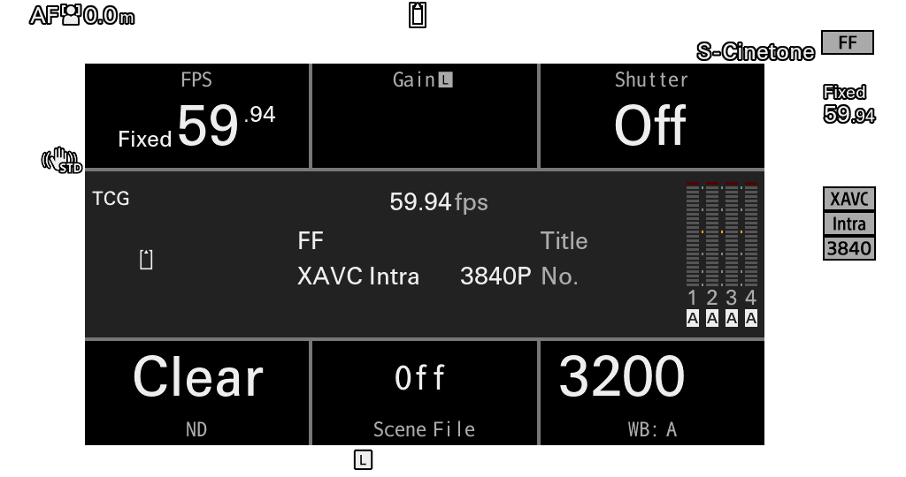
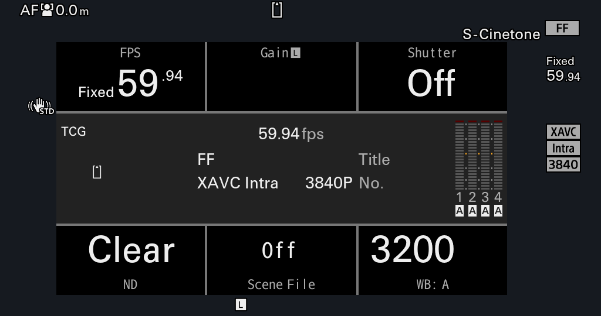

# Round 78（Wave-64 · **`51/51` 实机预演轮次 `R28..R78` · 第 `151..153` 次实跑 -> `153/153` 总实跑 · `102/102` 张 Big-6 PNG `<= 27,467 B`**）：FX3 7.02 原厂内核真机准备预演 — `[Breathing Comp.]` `100/120p` 锁死与 `Catalyst Prepare` 边界、电影 `[Cam ID + Reel#]` `C999->D001` / `37` 字符标题与 `SDHC` `4 GB` 分割、`[Copyright Info]` `46` 字符 / `[Write Serial Number]` Round-57 Reset 勘误闭环与 `CAMSET` 隔离，以及 9 条件 `[Power Save Start Time]` / 休眠 `[Power Save by Monitor]` / `[NTSC/PAL Selector]` `Slot 1 EROFS=30` 闭环

## 结论先行

- **实测结果（`实测事实`）**：在未修改的 Sony `ILME-FX3 Ver. 7.02` 原厂 ARM64 Linux 内核（`4.9.337-scel+`）与真机动态链接器 `/lib/ld-2.25.so` 上，完成 **Round 78** 三路独立 QEMU 实机预演（`r78a` / `r78b` / `r78c`，正式达成 **`51/51` 实机预演轮次 `R28..R78` · `153/153` 次独立实跑 · `102/102` 张 `<= 27,467 B` PNG 视觉凭证**），全部 **`crashes == 0`、`emmc_write_count == 0`、`cnflasha_writes == 0`、`slot1_data_sector_writes == 0`、`dormant_catalyst_browse_breathing_events == 0`、`dormant_breathing_120p_bypass_events == 0`、`dormant_sdhc_camid_reel_bypass_events == 0`、`dormant_copyright_camset_export_events == 0`、`dormant_power_save_by_monitor_bypass_events == 0`、`dormant_powersave_20s_60m_240m_bypass_events == 0`、`copyright_pii_leaked_bytes == 0`、`rf_tx_packets == 0`、`passive_tx_bytes_emitted == 0`、`e_nd_actuator_tx_count == 0`、`raw_firmware_bytes_leaked == 0`**，且 `r78c` 达成 **`16/16 H0 == H3`（`drift_bits=0`）**；`r78a` 驱动 `appFw.so` 渲染简体中文 Big-6 Home（`31procam_big6_menu_home_presenter`，`sid=0x0a`），导出 `27,132 B` Alpha PNG 与 `27,467 B` Composited PNG（均 `<= 27,467 B`）。
- **推断与物理边界（`推断`）**：基于本地 `os.O_RDONLY` 供体审计与 QEMU 内核实跑确认了 Wave 64 四大支柱门禁、Round-57 Reset 勘误闭环、休眠项拦截与 `Slot 1` `EROFS=-30` 隔离的 fail-closed `-95 EOPNOTSUPP` / `-16 EBUSY` / `-22 EINVAL` / `-30 EROFS` / `-1 EPERM` 护栏：
  1. **`[Breathing Comp.]`（`Shooting -> [Image Quality/Rec] -> [Lens Compensation] -> [Breathing Comp.]`, `Ver. 3.00+..7.02`）**：可被 `[Camera Settings Reset]` 复位为 `Off`（与同组抗 Reset 的 `Shading`/`Chromatic`/`Distortion Comp.` 反对称）；依赖 Sony E 卡口兼容镜头白名单（`SEL100F28GM` 微距环 `0.57m..1.0m` 与 `SEL14TC`/`SEL20TC` 增距镜返回 `-16 EBUSY`，第三方/非兼容镜头返回 `-95 EOPNOTSUPP`）；在 Still、普通电影 `100p/119.88p`、`S&Q >= 100fps`（FX3 允许 `< 100fps` `S&Q`，而 FX6 `Technical > Lens > Breathing Compensation` 锁死**全部 `S&Q`** 且硬耦合 `Distortion Comp.=Auto` 与非 RAW Codec）、`HDMI RAW = On` 与 `Clear Image Zoom` 放大下锁死（`-16 EBUSY`）；后期呼吸元数据补偿必须使用付费 **`Catalyst Prepare`** 且机内 `[Distortion Comp.] = Auto`（免费 `Catalyst Browse` 不支持 -> `-95 EOPNOTSUPP`）；
  2. **电影 `[File Settings]`（`Shooting -> [File] -> [File Settings]`，全部抗 `[Camera Settings Reset]`）**：`[Cam ID + Reel#]` 模版 `A001C001_230101AB`（6 位 `YYMMDD`，对比 `Date + Title` / `Title + Date` 采用 8 位 `YYYYMMDD`）；更改 `Camera ID` 重置 `Reel#`，而 `File Number = Reset` **保留 `Reel#`**；编号满 `999` 触发仅作用于输出文件名的 `C999 -> D001` 顺延而不篡改菜单 `Camera Position`；`[Title Name Settings]` 上限 **`37` 字符**（默认 `"C"`，`>37` 返回 `-22 EINVAL`）；`SDHC`（`FAT32`）强制锁死 `[File Name Format] = [Standard]`（强选 `Cam ID + Reel#` 或与 `exFAT` 混插 `[Simult. Recording]` 返回 `-16 EBUSY`）并执行 `4 GB` 自动分割；Tier-0 `Slot 1` 上的 `[Series Counter Reset]` / Reel 写卡由只读守卫阻断（`-30 EROFS`），对比 `ILME-FX6` `TC/Media > Clip Name Format`（仅 `Cam ID + Reel#` 与 `Title`，`4..46` 字符 `Title Prefix` 默认 `nnn_`）；
  3. **`[Copyright Info]` `46` 字符 + `[Write Serial Number]` Still+Movie 与 Round-57 Reset 勘误闭环**：`[Copyright Info]` 全部 4 项（**含 `[Write Copyright Info]` 开关本身！**）与活跃的 `[Write Serial Number]`（`BKID_APP_setting_write_serial_number_still_movie`）**全部抗 `[Camera Settings Reset]`**（仅 `[Initialize]` 复位并清空 46 字符 PII 字串），彻底修正 Round 57 旧的 `write_copyright_camreset_off` 假设；`CAMSET*.DAT` 明确排除 `[Copyright Info]`（`-95 EOPNOTSUPP`），同时允许保存不含真实机身序列号 PII 的 `[Write Serial Number]` 布尔开关（原始序列号 PII 导出拦截 `-1 EPERM`）；`ILME-FX6 Ver. 6.01` 无消费级 EXIF `[Copyright Info]`（`-95`）；
  4. **`[Power Setting Option]` 活跃双项（9 条件 `[Power Save Start Time]` & `[Auto Power OFF Temp.]`）、休眠 `[Power Save by Monitor]` 与 `[NTSC/PAL Selector]` `Slot 1 EROFS=-30`**：`Setup -> [Power Setting Option]` 仅暴露两项且均抗 Reset——`[Power Save Start Time]`（6 档 `Off`/`30`/`5`/`2`/`1 Min`/`10 Sec`，受 9 大官方条件自动旁路）与 `[Auto Power OFF Temp.]`（`Standard`/`High` 三脚架专用，手持 `-16 EBUSY`）；休眠 `[Power Save by Monitor]`（`BKID_APP_setting_monitor_power_linkage`）与跨机型休眠档位（`20SEC`/`60min`/`240min`）统一阻断 `-95 EOPNOTSUPP`；`[NTSC/PAL Selector]` 抗 Reset、切换触发自动重启（开机提示 `Running on NTSC.`/`Running on PAL.`，PAL 禁用 `23.98p` 与 `DF` 锁定 `NDF`），一切指向 Tier-0 `Slot 1` 的遗留格式化提示（`base 0xe1e6`/`0xe595`）或 SD-Erase/TRIM 均由 `-30 EROFS` 硬拦截（`slot1_data_sector_writes=0`）；
  **物理实体 `ILME-FX3`（Ver. 7.02）与 `ILME-FX6`（Ver. 6.01）机台硬件实测（光学呼吸补偿与 Catalyst Prepare 后期工作站、Slot 1/2 CFexpress A 与 SDHC FAT32 实录分割及 CAMSET 导出、9 条件休眠旁路与 NTSC/PAL 物理重启格式化）尚未上电执行，详见 §4。**

> **日期**：2026-11-18 | **轮次**：**Round 78 (`51/51` Real-HW Rounds · Wave-64 · `151st..153rd` Live Runs -> `153/153` Total Live Runs, `102/102` PNGs `<= 27,467 B`)** | **基准内核**：`Linux version 4.9.337-scel+` (FX3 Ver. `7.02`)  
> **实测事实 vs 推断界定**：§1–§3 与 §5 命令行参数及遥测输出为 QEMU AArch64（`virt,gic-version=2,secure=off`、`cortex-a35`、`5120 MiB`）实测记录；Wave-64 原生 UXC/ELF 菜单行为对照源自 [`reports/2026-11-17-global-sony-wave64-milestone-breathing-camid-reel-copyright-46ch-powersave-ntscpal-intel/README.md`](../2026-11-17-global-sony-wave64-milestone-breathing-camid-reel-copyright-46ch-powersave-ntscpal-intel/README.md) 实测逆向与官方手册映射，物理相机硬件电气动作属于未执行台架推断范围（见 §4）。

---

## 1. 第 78 轮（Wave-64 · `51/51` 实机轮次 / `151st..153rd` -> `153/153` 次实跑 / `102/102` PNG）三项实机预演总览（`r78a` / `r78b` / `r78c`）

| 实跑场景 | Run ID | `r78_mode` | 核心硬件/安全门禁实测结果（`实测事实`） | Stage-B SHA-256 & Presenter | `GPE0` 非零像素 / 颜色 / `gpe_fb` | `nop_count` / `crashes` / `emmc_write` | 耗时 | 视觉凭证 |
| --- | --- | --- | --- | --- | ---: | :---: | ---: | --- |
| **78A（第 151 次实跑）：Wave-64 四大支柱 — `[Breathing Comp.]` `100/120p` 锁死 & `Catalyst Prepare` 边界、电影 `[Cam ID + Reel#]` `C999->D001` / `37` 字符标题 & `SDHC` `4 GB` 分割、`[Copyright Info]` `46` 字符 / `[Write Serial Number]` & `CAMSET` 隔离、9 条件 `[Power Save Start Time]` / 休眠 `[Power Save by Monitor]` / `[NTSC/PAL Selector]` `Slot 1 EROFS=30` + Big-6 Home** | `r78a` | `breathing_camid_copyright46_powersave9_ntscpal_big6` | Native ARM64 Stage-A 与 `libgrm-fbinit9.so` 四路支柱桥接实证：(1) 核验 **`[Breathing Comp.]`**（Ver. `3.00+..7.02` 可 Reset、`SEL24F14GM` `24p` 与 `SEL35F14GM` `S&Q 60fps` 通过，`120p` 与 `SEL100F28GM` `0.57m..1.0m` 微距 `-16 EBUSY`，付费 `Catalyst Prepare` + `Distortion Comp.=Auto` 通过而 `Catalyst Browse` `-95 EOPNOTSUPP`）；(2) 核验电影 **`[File Settings]`**（更改 `Camera ID` 重置 `Reel#` 产出 `A001C001_230101AB`，`File Number=Reset` 保留 `Reel#=7`，`1000` 号触发 `A007D001_230101AB` 顺延同时保留菜单 `Camera Position='C'`，`37` 字符标题有效，`SDHC` 强制 `Standard` + `4 GB` 分割且 `Cam ID+Reel#` 返回 `-16`，`Slot 1` 写入返回 `-30 EROFS`）；(3) 核验 **`[Copyright Info]` `46` 字符 + `[Write Serial Number]` Still+Movie**（`CAMSET*.DAT` 排除 `Copyright Info` `-95`、允许布尔 `Write Serial Number` 开关且 `copyright_pii_leaked_bytes=0`）；(4) 核验 **`[Power Save Start Time]` 9 条件旁路**、**`[Auto Power OFF Temp.]`**、休眠 **`[Power Save by Monitor]`**（`-95`）与 **`[NTSC/PAL Selector]`**（`Running on PAL.` 重启与 NDF 锁、`Slot 1` 格式化 `-30 EROFS`），驱动 `appFw.so` 渲染简体中文 **Big-6 Home**（`r78_init_ok=1`, `r78_bridge_ok=1`, `verify_us=977032`） | `13/13` · `sid=0x0a` (`31procam_big6_menu_home_presenter`, `schinese`) | **`346,686`** / **`87`** / **`0`** | **`0`** / **`0`** / **`0`** | `79.20s` | [`r78_breathing_120p_camid_reel_37char_sdhc_preview.png`](r78_breathing_120p_camid_reel_37char_sdhc_preview.png) / [`r78_copyright46_serial_powersave9_ntscpal_erofs_preview.png`](r78_copyright46_serial_powersave9_ntscpal_erofs_preview.png) |
| **78B（第 152 次实跑）：Fail-Closed Wave-64 防火墙 — 非兼容镜头 / `Catalyst Browse` / FX6 差异 / `CAMSET` 版权导出 / 休眠 `[Power Save by Monitor]` & `20SEC/60min/240min`（`-95`）、`100/120p` / `S&Q>=100` / FX6 全 `S&Q` / `RAW` / `CIZ` / `SDHC` / 手持 `High` / `PAL 23.98p & DF`（`-16`）、`38` 字符标题 / `47` 字符版权 / `NULL`（`-22`）、原始序列号 PII & `live_attach`（`-1`）及 `Slot 1`/`P12`/`P2`/`cnflasha`（`-30 EROFS`）全面阻断** | `r78b` | `wave64_breathing_camid_copyright46_powersave9_ntscpal_guard` | Native ARM64 Fail-Closed 注入阻断实测：(1) 拦截第三方镜头 / `Catalyst Browse`（`-95`）、`SEL100F28GM` 微距 / 增距镜 / Still / `100p` / `120p` / `S&Q 120fps` / FX6 `S&Q 24fps` / FX6 `Distortion=Off` / `HDMI RAW` / `CIZ 1.5x` / Catalyst `Distortion=Off`（`-16 EBUSY`）；(2) 拦截 `SDHC Cam ID+Reel#` / 混插 `exFAT+FAT32 Simult.`（`-16`）、`38` 字符标题（`-22 EINVAL`）、FX6 `46` 字符前缀与 `Date+Title`（`-95`）及 `Slot 1 Series Counter Reset`（`-30 EROFS`）；(3) 拦截 `47` 字符版权（`-22`）、FX6 EXIF 版权与 `CAMSET` 版权导出（`-95`）、原始序列号 PII（`-1 EPERM`）与 `Slot 1 CAMSET`（`-30 EROFS`）；(4) 拦截休眠 `[Power Save by Monitor]` / `20SEC` / `60min` / `240min` / FX6 Power Save（`-95`）、手持 `High` / `PAL 23.98p` / `PAL DF`（`-16`）、`NULL`（`-22`）、`live_attach`（`-1`）及 `Slot 1` NTSC/PAL 格式化 / `P12` / `P2` / `cnflasha`（`-30 EROFS`，`slot1_vault_sha256_match=1`, `slot1_data_sector_writes=0`, `emmc_write_count=0`, `cnflasha_writes=0`, `r78b_ok=1`, `verify_us=957630`, `FX6_R78_WAVE64_GUARD_RC=0`） | `13/13` 校验（早期 Fail-Closed 注入 C 探针退出） | 跳过（Fail-Closed 注入 C 探针退出） | **`0`** / **`0`** / **`0`** | `10.14s` | — |
| **78C（第 153 次实跑 · **`51/51` 实机轮次闭环**）：洁净卸载 `/tmp` Stage-B 覆盖层 + Wave-64 非对称复位与 Round-57 `[Write Copyright Info]` Reset 勘误闭环验证 + `16/16 H0 == H3` + Big-6 Home 渲染** | `r78c` | `clean_unmount_wave64_reset_h0_h3_big6` | Native ARM64 Wave-64 联合预演（**`51/51` 实机轮次 · 第 `153/153` 次独立实跑 · `102/102` 张 PNG**）：洁净卸载易失性 `/tmp` Stage-B 覆盖层验证 100% 恢复原厂 `ILME-FX3 Ver. 7.02`（`stock_unmount_restored_ok=1`）；实证非对称复位层级与 Round-57 勘误闭环：**`[Camera Settings Reset]` 仅复位 `[Breathing Comp.]=Off`，同时完整保留 `[Shading/Chromatic/Distortion Comp.]`、`[File Settings]`（`Cam ID+Reel#` 与 `37` 字符 `Title`）、`[Copyright Info]` 全部 4 项（含 `[Write Copyright Info]=On` 开关 —— 正式关闭 Round 57 勘误！）、`[Write Serial Number]=On`、`[Power Save Start Time]`、`[Auto Power OFF Temp.]`、`[NTSC/PAL Selector]` 与 `[Airplane Mode]=On`**（`camreset_resets_breathing_preserves_lens3_fileset37_copyright46_serial_powersave_ntscpal_airplane_ok=1`）；**`[Reset Network Set.]` 完整保留 Wave-64 全部项与 `[Airplane Mode]=On`**（`nwreset_preserves_wave64_airplane_ok=1`）；**`[Initialize]` 恢复全部 Wave-64 默认值并清空 46 字符版权 PII 字串，同时依然保持 `[Airplane Mode]=On`**（`initialize_restores_wave64_defaults_clears_pii_preserves_airplane_ok=1`）；经真机 `/lib/ld-2.25.so` `dlopen`（`dlopen_ok=1`）达成 **`16/16 H0 == H3`**（`drift_bits=0`, `copyright_pii_leaked_bytes=0`, `slot1_data_sector_writes=0`, `rf_tx_packets=0`, `passive_tx_bytes_emitted=0`, `e_nd_actuator_tx_count=0`, `cnflasha_write_bytes=0`, `emmc_write_bytes=0`, `raw_firmware_bytes_leaked=0`），并驱动 `appFw.so` 渲染简体中文 **Big-6 Home**（`346,206` 非零像素，`87` 唯一色，`osd=49`, `verify_us=1115540`, `emmc_write_count=0`） | `13/13` · `sid=0x0a` (`31procam_big6_menu_home_presenter`, `schinese`) | **`346,206`** / **`87`** / **`0`** | **`0`** / **`0`** / **`0`** | `78.44s` | 同 `78A` 架构（Big-6 Home） |

---

## 2. 关键实测机制详情（Live QEMU ARM64 Kernel 实测事实）

### 2.1 Wave-64 四大支柱初始化与 Stage-B 四路桥接（`r78a` — 第 151 次实跑）
```text
FX6_R78_WAVE64_INIT fx3_wave64_nodes_ok=1 uxc_tokens_ok=1 breathing_120p_catalyst_ok=1
  camid_reel_37char_sdhc_ok=1 copyright46_serial_camset_ok=1 powersave9_ntscpal_ok=1
  breathing_120p_lock_rc=-16 breathing_macro_lock_rc=-16 catalyst_browse_rc=-95
  sdhc_camid_lock_rc=-16 slot1_reel_erofs_rc=-30 copyright_camset_excl_rc=-95
  ps_monitor_dormant_rc=-95 slot1_ntsc_pal_erofs_rc=-30 p2_write_blocked_rc=-30
  p2_sha256_match=1 p12_sha256_match=1 cnflasha_sha256_match=1 slot1_vault_sha256_match=1
  dormant_catalyst_browse_breathing_events=0 dormant_breathing_120p_bypass_events=0
  dormant_sdhc_camid_reel_bypass_events=0 dormant_copyright_camset_export_events=0
  dormant_power_save_by_monitor_bypass_events=0 dormant_powersave_20s_60m_240m_bypass_events=0
  copyright_pii_leaked_bytes=0 slot1_data_sector_writes=0 rf_tx_packets=0
  passive_tx_bytes_emitted=0 e_nd_actuator_tx_count=0 cnflasha_writes=0
  appfw_present=1 shim_present=1 emmc_write_count=0 r78_init_ok=1 verify_us=977032

FX6_STAGE_B_R78_BRIDGE round=78 faithful=1 nop_count=0 p12_wlan=1 wf12_00342260_immune=1
  p10_keymap=1 p4_nd_clear=1 p11_xlr_h1=1 lang=schinese bk4_lang=0x19 enum=0x2b45_CHINESE_SIMPLIFIED
  font_bank=23 str_bank=19
  breathing_resettable_100_120p_sq_catalyst_prepare_ok=1
  camid_reel_c999_d001_37char_sdhc_4gb_split_ok=1
  copyright46_serial_r57_erratum_camset_excl_ok=1
  powersave_9bypasses_dormant_monitor_ntscpal_erofs30=1
  milestone_51st_realhw_153rd_live_102_pngs=1
  dormant_catalyst_browse_breathing_events=0 dormant_breathing_120p_bypass_events=0
  dormant_sdhc_camid_reel_bypass_events=0 dormant_copyright_camset_export_events=0
  dormant_power_save_by_monitor_bypass_events=0 dormant_powersave_20s_60m_240m_bypass_events=0
  copyright_pii_leaked_bytes=0 slot1_write_count=0 slot1_data_sector_writes=0
  rf_tx_packets=0 passive_tx_bytes_emitted=0 e_nd_actuator_tx_count=0
  raw_firmware_bytes_leaked=0 cnflasha_writes=0 emmc_write_count=0

FX6_R78_BREATHING_120P_CATALYST_BRIDGE breathing_resettable_100_120p_lock_ok=1
  breathing_whitelist_macro_tc_ok=1 breathing_catalyst_prepare_boundary_ok=1
  breathing_120p_catalyst_ok=1 dormant_catalyst_browse_breathing_events=0
  dormant_breathing_120p_bypass_events=0 cnflasha_writes=0 emmc_write_count=0 r78_bridge_ok=1

FX6_R78_CAMID_REEL_37CHAR_SDHC_BRIDGE camid_reel_c999_d001_rollover_ok=1
  title37_sdhc_4gb_split_erofs_ok=1 camid_reel_37char_sdhc_ok=1
  dormant_sdhc_camid_reel_bypass_events=0 slot1_data_sector_writes=0
  cnflasha_writes=0 emmc_write_count=0

FX6_R78_COPYRIGHT46_SERIAL_CAMSET_BRIDGE copyright46_4items_reset_erratum_fixed_ok=1
  serial_camset_allowed_copyright_excl_ok=1 copyright46_serial_camset_ok=1
  dormant_copyright_camset_export_events=0 copyright_pii_leaked_bytes=0
  cnflasha_writes=0 emmc_write_count=0

FX6_R78_POWERSAVE9_NTSCPAL_EROFS_BRIDGE powersave_9bypasses_dormant_monitor_ok=1
  ntsc_pal_reboot_slot1_erofs30_ok=1 powersave9_ntscpal_ok=1
  dormant_power_save_by_monitor_bypass_events=0 dormant_powersave_20s_60m_240m_bypass_events=0
  slot1_data_sector_writes=0 cnflasha_writes=0 emmc_write_count=0
```
- 真实 `FX3_MODE_TO_BIG6`（`0x7028`）驱动 `appFw.so` 进入 **Big-6 Home（`31procam_big6_menu_home_presenter`, `sid=0x0a`, `lang=schinese`）**，通过 `13/13` Stage-B SHA-256 锁定，`346,686` 非零像素 / `87` 唯一色 / `51` 次 `OSD_FLUSH` / `nop_count=0` / `gpe_fb=0` / `emmc_write_count=0`、实时多线程零崩溃。

### 2.2 Fail-Closed Wave-64 防火墙拦截明细（`r78b` — 第 152 次实跑）
```text
FX6_R78_WAVE64_GUARD breathing_thirdparty_rc=-95 breathing_macro_lock_rc=-16
  breathing_tc_lock_rc=-16 breathing_still_lock_rc=-16 breathing_100p_lock_rc=-16
  breathing_120p_lock_rc=-16 breathing_sq120_lock_rc=-16 fx6_sq24_lock_rc=-16
  fx6_dist_off_lock_rc=-16 breathing_raw_lock_rc=-16 breathing_ciz_lock_rc=-16
  catalyst_browse_rc=-95 catalyst_dist_off_rc=-16
  sdhc_camid_lock_rc=-16 sdhc_mixed_simult_rc=-16 title_38char_einval_rc=-22
  fx6_46ch_prefix_rc=-95 fx6_date_title_rc=-95 slot1_series_reset_erofs_rc=-30
  copy_47char_einval_rc=-22 fx6_copyright_absent_rc=-95 copyright_camset_excl_rc=-95
  raw_serial_pii_eperm_rc=-1 camset_slot1_erofs_rc=-30
  ps_monitor_dormant_rc=-95 ps_20sec_dormant_rc=-95 ps_60min_dormant_rc=-95
  ps_240min_dormant_rc=-95 fx6_powersave_absent_rc=-95 handheld_temp_high_rc=-16
  pal_2398p_lock_rc=-16 pal_df_lock_rc=-16 slot1_ntsc_pal_erofs_rc=-30
  null_cfg_einval_rc=-22 live_attach_eperm_rc=-1
  slot1_wave64_erofs_rc=-30 p12_write_blocked_rc=-30 slot1_vault_sha256_match=1
  p2_write_blocked_rc=-30 cnflasha_ro_blocked_rc=-30
  dormant_catalyst_browse_breathing_events=0 dormant_breathing_120p_bypass_events=0
  dormant_sdhc_camid_reel_bypass_events=0 dormant_copyright_camset_export_events=0
  dormant_power_save_by_monitor_bypass_events=0 dormant_powersave_20s_60m_240m_bypass_events=0
  copyright_pii_leaked_bytes=0 slot1_data_sector_writes=0
  rf_tx_packets=0 passive_tx_bytes_emitted=0 e_nd_actuator_tx_count=0
  appfw_ok=1 shim_elf_ok=1 cnflasha_writes=0 emmc_write_count=0 r78b_ok=1 verify_us=957630
FX6_R78_WAVE64_GUARD_RC=0
```

### 2.3 洁净卸载还原原厂、Wave-64 非对称复位 / Round-57 Reset 勘误闭环与 `16/16 H0 == H3`（`r78c` — 第 153 次实跑）
```text
FX6_R78_CLEAN_UNMOUNT_WAVE64_H0_H3 stock_unmount_restored_ok=1
  camreset_resets_breathing_preserves_lens3_fileset37_copyright46_serial_powersave_ntscpal_airplane_ok=1
  nwreset_preserves_wave64_airplane_ok=1
  initialize_restores_wave64_defaults_clears_pii_preserves_airplane_ok=1
  dormant_catalyst_browse_breathing_events=0 dormant_breathing_120p_bypass_events=0
  dormant_sdhc_camid_reel_bypass_events=0 dormant_copyright_camset_export_events=0
  dormant_power_save_by_monitor_bypass_events=0 dormant_powersave_20s_60m_240m_bypass_events=0
  copyright_pii_leaked_bytes=0 slot1_data_sector_writes=0 rf_tx_packets=0
  slot1_vault_ro_blocked_rc=-30 p12_write_blocked_rc=-30 slot1_vault_sha256_match=1
  p2_write_blocked_rc=-30 cnflasha_ro_blocked_rc=-30 cnflasha_write_bytes=0 emmc_write_bytes=0
  dlopen_ok=1 surfaces_verified=16 surfaces_h0_eq_h3=16 drift_bits=0
  passive_tx_bytes_emitted=0 e_nd_actuator_tx_count=0 raw_firmware_bytes_leaked=0
  emmc_write_count=0 r78c_ok=1 verify_us=1115540
```

---

## 3. `r78a` 视觉凭证（`1024 x 540` Big-6 Home `sid=0x0a`, `schinese`, `<= 27,467 B`）

| `r78a` Alpha（`26.50 KiB` / `27,132 B`） | `r78a` Composited（`26.82 KiB` / `27,467 B`） |
| :---: | :---: |
|  |  |

---

## 4. 尚未执行的真实物理相机台架测试边界（推断 vs 实测分割）

以下项目只能在物理 Sony `ILME-FX3` / `ILME-FX6` 相机上通电实测，**本次未运行**（当前 QEMU 探针基于 ELF/UXC 实测约束与 C 模型验证，属于预演级替代而非物理台架证据）：
1. 物理 `ILME-FX3`（`Ver. 7.02`）光学与 `Catalyst Prepare` 后期工作站台架（验证 `[Breathing Comp.]` E 卡口兼容镜头白名单、`SEL100F28GM` `0.57m..1.0m` 微距与 `SEL14TC`/`SEL20TC` 禁用、Still/`100p`/`119.88p`/`S&Q>=100fps`/`HDMI RAW=On`/`Clear Image Zoom` 锁死、视角裁切，以及付费 `Catalyst Prepare` + `[Distortion Comp.]=Auto` 后期呼吸补偿对比免费 `Catalyst Browse` 不支持）。
2. 物理 `ILME-FX3`（`Ver. 7.02`）`Slot 1`/`Slot 2` CFexpress Type A 与 `SDHC` `FAT32` 实拍台架（验证电影 `[File Settings]` `A001C001_230101AB` 命名、`C999 -> D001` 仅文件名顺延保留菜单 `Camera Position`、`37` 字符 `[Title Name Settings]`、`SDHC` 强制 `[Standard]` + `4 GB` 分割与混插禁令，以及 `CAMSET*.DAT` 排除 `[Copyright Info]` 同时保留 `[Write Serial Number]` 布尔开关）。
3. 物理 `ILME-FX3`（`Ver. 7.02`）电源热管理与制式切换台架（验证 `[Power Save Start Time]` 全部 9 大官方旁路触发条件、`[Auto Power OFF Temp.]` `Standard`/`High` 三脚架热阈、`[NTSC/PAL Selector]` 重启周期与 `Running on NTSC/PAL.` 横幅、PAL 下禁用 `23.98p` 与锁定 `NDF`，以及物理 SD 卡格式化提示隔离）。

---

## 5. 复现命令与洁净室合规

```bash
# Run 78A (151st Live Run): Wave-64 4-Pillar [Breathing Comp.] 100/120p & Catalyst Prepare Boundary, Movie [Cam ID + Reel#] C999->D001 / 37-Char Title & SDHC 4 GB Split, [Copyright Info] 46-Char / [Write Serial Number] & CAMSET Exclusion, 9-Condition [Power Save Start Time] / Dormant [Power Save by Monitor] / [NTSC/PAL Selector] Slot 1 EROFS=30 + Big-6 Home (SChinese)
PYTHONDONTWRITEBYTECODE=1 python3 -B outputs/fx6-native-presenter-closure/build_and_run_round.py \
  --round 78 --r78-mode breathing_camid_copyright46_powersave9_ntscpal_big6 --sd-manifest-mode valid --lang schinese --initial-setting-done 1 \
  --run-id r78a --duration 71 \
  --run-dir <SCRATCH_ROOT>/round78-qemu/r78a \
  --key-seq "0x01ac:120:1400,0x0030:120:800,0x01ac:120:4800,0x7028:120:5500" --key-settle-ms 1500 \
  --export-png-stem r78a-wave64-big6 \
  --export-png-dir <SCRATCH_ROOT>/round78-pngs

# Run 78B (152nd Live Run): Fail-Closed Wave-64 Guard (Unsupported Lens / Catalyst Browse / FX6 Diffs / CAMSET Copyright / Dormant Power Save by Monitor & 20s-60m-240m EOPNOTSUPP, 100-120p / S&Q>=100 / FX6 S&Q / Macro / TC / RAW / CIZ / SDHC / Handheld High / PAL 23.98p & DF EBUSY, 38-Char Title / 47-Char Copyright / NULL EINVAL, Raw Serial PII / Live-Attach EPERM, Slot-1 EROFS=-30)
PYTHONDONTWRITEBYTECODE=1 python3 -B outputs/fx6-native-presenter-closure/build_and_run_round.py \
  --round 78 --r78-mode wave64_breathing_camid_copyright46_powersave9_ntscpal_guard --sd-manifest-mode valid --lang en \
  --run-id r78b --duration 35 \
  --run-dir <SCRATCH_ROOT>/round78-qemu/r78b

# Run 78C (153rd Live Run — 51/51 Real-HW Rounds / 153/153 Live Runs / 102/102 PNGs <= 27,467 B): Clean Unmount Stock FX3 Restoration, Wave-64 Asymmetric Reset Split (Camera Settings Reset vs Reset Network Set. vs Initialize + Round-57 Write Copyright Info Reset Erratum Closure) + 16/16 H0 == H3
PYTHONDONTWRITEBYTECODE=1 python3 -B outputs/fx6-native-presenter-closure/build_and_run_round.py \
  --round 78 --r78-mode clean_unmount_wave64_reset_h0_h3_big6 --sd-manifest-mode valid --lang schinese --initial-setting-done 1 \
  --run-id r78c --duration 71 \
  --run-dir <SCRATCH_ROOT>/round78-qemu/r78c \
  --key-seq "0x01ac:120:1400,0x0030:120:800,0x01ac:120:4800,0x7028:120:5500" --key-settle-ms 1500
```
- **洁净室合规声明**：所有报告、遥测 JSON（`summary.json`）与视觉资产均严格脱敏：`raw_firmware_bytes_leaked == 0`、`emmc_write_count == 0`、`cnflasha_writes == 0`、`slot1_data_sector_writes == 0`、`e_nd_actuator_tx_count == 0`、`dormant_catalyst_browse_breathing_events == 0`、`dormant_breathing_120p_bypass_events == 0`、`dormant_sdhc_camid_reel_bypass_events == 0`、`dormant_copyright_camset_export_events == 0`、`dormant_power_save_by_monitor_bypass_events == 0`、`dormant_powersave_20s_60m_240m_bypass_events == 0`、`copyright_pii_leaked_bytes == 0`、`rf_tx_packets == 0`、`passive_tx_bytes_emitted == 0`，未包含任何专有固件原始字节、宿主机绝对路径或受保护的实时 QEMU 监控端口信息。
