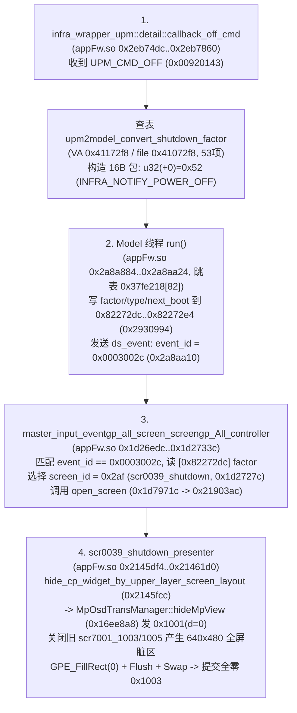

# FX3 7.02 显示契约与原生关机/清黑（`scr0039_shutdown`）静态取证报告

## 1. 核心结论（Conclusion First）

1. **两轮黑帧（用户 `try2-70588c4c` 与内部 `try2gapinternal-47e2924a`）的直接根因已由原厂二进制与只读串口日志双向闭环证明：并非多平面合成缺失，也不是 GPE 渲染异常，而是 AP 原生进入了关机屏幕 `scr0039_shutdown`（`screen_id = 0x2af`）**。
   - 在 `try2-70588c4c` 中，`serial.log` 字节 `17840178` 出现原厂 `open screen: scr7001_1005 -> scr0039_shutdown`（`id1=0x289, id2=0x2af, id3=0x289`）；随后 `scr0039_shutdown_presenter::hide_cp_widget_by_upper_layer_screen_layout()`（`appFw.so` `0x2145fcc -> 0x16ee8a8`）下发 `0x1001` 隐藏 MP 视图（使 `config_hash` 从 `0xa8adcf1048b59ea7` 变为 `0x4741982a43f9e4bf`），同时关闭 `scr7001_1005` 触发全屏 `640x480` 脏区。因 `scr0039_shutdown` 无可见 GUI 位图控件，`GraphicsEngine::drawFramebuffer`（`libObj.so` `0x16ea10`）在后台缓冲 `off_entry`（`token=0x402`, `0x43feb5100`）执行 `GPE_FillRect(seq=1198, color=0)` + `GPE_Flush(seq=1199)`，调用 `FrameBuffer::swap`（`0xf33d0`）将 `on_entry` 切为 `token=0x402`，并提交真实全零的 `0x1003`（`frame=373`），此后 `0x1005`（`frame=374..`）持续无交换刷新该全零表面。
   - 在 `try2gapinternal-47e2924a` 中，`serial.log` 字节 `23494922`（**早于** `step=2 key=0x15` 的字节 `24653534`）已进入 `open screen: scr7001_1003 -> scr0039_shutdown`（`id1=0x275, id2=0x2af, id3=0x275`）。因此后续 `step=2/3/4`（`Left/Left/Down`）注入时当前活动屏幕已是 `scr0039_shutdown`，必然无菜单焦点变化；待 `FX3_OSD_DRAW_WAIT_RETURN frame=1310` 返回后，GUI 线程在当时后台缓冲 `off_entry`（`token=0x401`, `0x43ae96100`）执行 `GPE_FillRect(seq=717, color=0)` + `GPE_Flush(seq=718)`，交换 `on_entry` 为 `token=0x401` 并提交全零 `0x1003`（`frame=1311`，`config_hash` 从 `0x8e09d7f5ffd3b3ea` 变为 `0xe144925f50ebce45`）。
2. **`0x1000..0x1005` 的真实原厂消费者及 `0x6003`/`0x6005`、`0x2001`/`0x2002` 的真实原厂发送者已在 `av-cam.bin`（`osdTrans::OsdDataManager` / `osdTrans::CmdProcessorApp`，VA `0xffffffc0012ee180..0xffffffc0012ef520`）中完整定位并反汇编证明**，下游 `0x2001`/`0x2002` 消费者在 `cpapp-b.bin`（`0x4b3628..0x4b39c0` 与 `0xa902b0..0xa90700`）闭环。
3. **当前 Runtime Helper（`fx3-osd-core-v4-frame.h` / `fx3-osd-owner-core-v1.h` / `fx3-osd-headless-v7-observe102.c`）存在 3 处可证明语义缺失**：
   - `fx3-osd-headless-v7-observe102.c:62` 的 `ring_commit` 仅向共享环槽写入 `w[20]=f->config_hash`，从未将进程私有的 `configs[256*96+80+16]`（24,672 字节）拷入共享环槽或导出，导致宿主机只能看到 `config_hash` 变化而看不到具体哪个 plane/output 被隐藏；
   - `fx3-osd-owner-core-v1.h:94` 的 `qo_GUI` 对 `FX3_OSD_OWNER_GUI` 做了 `count <= 30 || count % 100 == 0` 限流且不解码字段，导致 `scr0039_shutdown` 触发的 `0x1001` 隐藏包在串口日志中被完全静默；
   - 缺少对 `0x1002`（`av-cam.bin` `FixTransInfo` `0x2ee50c`）staging→active 快照语义及原生关机/消隐屏幕（`scr0039_shutdown` `0x2af`）的显式状态标记。**绝不能通过保留旧帧像素或叠加旧截图掩盖全零 `0x1003` 提交**。

---

## 2. 固定原件 SHA256 与 VA→文件偏移映射证据

所有分析均基于只读原件，由 [`verify_display_contract.py`](file:///Volumes/KAFU2T/AI/Projects/Mac/work/fx3-vm-20261101/lead-codex/vm-optimization-20261103/display-contract/verify_display_contract.py) 强校验 SHA256：

| 组件 | 原件路径 | SHA256 | VA → 文件偏移映射规则 |
| :--- | :--- | :--- | :--- |
| `appFw.so` | [`appFw.so`](file:///Volumes/KAFU2T/AI/Projects/Mac/work/fx3-vm-20261101/fx3-audit/original-members/nflasha15/lib/appFw.so) | `545c5053a74e04ffbf2bbaaf80f558092dd545ed2298b2395ca547dbba58290f` | `PT_LOAD[0]`: `VA 0x0..0x3d0f79d` → `file = VA` (`delta=0`)<br>`PT_LOAD[1]`: `VA 0x3d20000..0x4b6a730` → `file = VA - 0x10000` |
| `libObj.so` | [`libObj.so`](file:///Volumes/KAFU2T/AI/Projects/Mac/work/fx3-vm-20261101/fx3-audit/original-members/nflasha15/lib/libObj.so) | `c4681d209a7fe2ed63752be3b0be89ab7b7ce400679c00068c8c6e47d39f83ae` | `PT_LOAD[0]`: `VA 0x0..0x2405d5` → `file = VA` (`delta=0`)<br>`PT_LOAD[1]`: `VA 0x250aa8..0x2cdcc8` → `file = VA - 0x10000` |
| `av-cam.bin` | [`av-cam.bin`](file:///Volumes/KAFU2T/AI/Projects/Mac/work/sony-firmware-20261024/stage2/extraction/files/nflasha3/av-cam.bin) | `0cb7e03a59b4ec3d7633664ab0f7a9477892d1aaf442b9db83a7e9a62a49bdaf` | AArch64 RTOS 镜像：`VA_BASE = 0xffffffc001000000` → `file = VA - 0xffffffc001000000` |
| `cpapp-b.bin` | [`cpapp-b.bin`](file:///Volumes/KAFU2T/AI/Projects/Mac/work/sony-firmware-20261024/stage2/extraction/files/nflasha8/cpapp-b.bin) | `c90d00d807874a5309dc1b65b203287e83608ceee513cc57b53409333fb6bcba` | ARM32/Thumb-2 RTOS 镜像：`VA_BASE = 0x00108000` → `file = VA - 0x00108000` |

---

## 3. 显示契约全链路证据表（Producer → Queue → Consumer → Reply/Forward）

### 3.1 消息与表面/图层契约总表

| Opcode / 队列 / 大小 | AP 端生产者（`appFw.so` / `libObj.so`） | AV 端实际消费者（`av-cam.bin` `osdTrans`） | 可证明字节布局与字段语义（禁止猜测） | 下游动作 / 回执语义 |
| :--- | :--- | :--- | :--- | :--- |
| **`0x1000`**<br>`0x8280074d`<br>**80B (`0x50`)** | `appFw.so` `0x16ee7c8` (`MpOsdTransManager::sendOutputDevice`)；由 `0x2191e08..0x2191ecc` 调用 | `av-cam.bin` 文件偏移 `0x2ee40c` (`VA 0xffffffc0012ee40c`, `OsdDataManager::SetOutputDeviceInfo`) | `+0x00 u16`: `0x1000`<br>`+0x04 u16`: `0`<br>`+0x08 u32`: `output_device`（`appFw.so` `0x2191e1c` 将显示模式 `1->9, 0->11, 2->2` 写入；存入 `osdDataMgr+0x14`）<br>`+0x0c u32`: `hide_count`（`av-cam.bin` `0x2ee420` 强校验 `cmp w8, #0x10`，`>16` 报错拒绝；存入 `osdDataMgr+0x28`）<br>`+0x10..0x4f u32[16]`: `hide_targets`（拷入 `osdDataMgr+0x2c..0x6b`） | 置 `byte[osdDataMgr+0x161] = 1` (`output_device_dirty`)；无单包回执，待 `0x1002` 快照生效 |
| **`0x1001`**<br>`0x8280074d`<br>**96B (`0x60`)** | `appFw.so` `0x16ee6f8` (`sendMpGuiBitmapLayout`, `w=2`)、`0x16ee8d8` (`sendMpViewLayout`, `w=12..15`)、`0x176fc2c` (`view_mp_widget_base::update_widget_info`) | `av-cam.bin` 文件偏移 `0x2ee2dc` (`VA 0xffffffc0012ee2dc`, `OsdDataManager::SetCpWidgetInfo`) | `+0x00 u16`: `0x1001`<br>`+0x04 u16`: `0`<br>`+0x08 u16`: `w`（图层/控件 ID；`av-cam.bin` `0x2ee314` 校验 `cmp x8, #0x100`；其中 **`w=2` 为 GUI 位图平面**，`w=12..15` 为 MP View 平面）<br>`+0x0a u16`: `d`（**可见性 boolean**：`1`=显示，`0`=隐藏；`0x176fc50` 由 `getMode() != 3` 生成）<br>`+0x0c u16`: `enable`（常 `1`）<br>`+0x10..0x16 u16[4]`: `x, y, width(640), height(480)`<br>`+0x18 u32`: `z_order`（**`w=2` GUI 位图固定 `0x1f=31`**；**`w=12..15` 及 CP widget 固定 `0x0b=11`**）<br>`+0x1c u32`: `attr_count`（`1`，`0x2ee370` 循环拷贝上限）<br>`+0x20..0x5f u32[16]`: `attrs[]` | 写入 `av-cam.bin` 暂存表 `0xffffffc001bb6508 + w * 0x58`（每项 88B），置 `byte[osdDataMgr+0x162] = 1`；无单包回执 |
| **`0x1002`**<br>`0x8280074d`<br>**12B (`0x0c`)** | `libObj.so` `0xf1d90` (`ExternalOSDIF`)，由 `0xf2fa0` 在每次提交/刷新前发送 | `av-cam.bin` 文件偏移 `0x2eed34` & `0x2ef014` (`WaitAndExecuteUpdateExec`) | `+0x00 u16`: `0x1002`<br>`+0x08 u32`: `sub_opcode`（`0x1003` 或 `0x1005`） | 先调用 **`OsdDataManager::FixTransInfo()`（`0x2ee50c`）**：将 256 项 `CpWidgetInfo`（`0x5800` 字节：`0xbb6508 -> 0xbbbd08`）、`outputDevice`（`+0x14 -> +0x94`）、`timer_info`（`+0x110 -> +0x120`）从 staging 区原子快照到 active 区；随后阻塞等待 `0x8280084d` (`0x1003`) 或 `0x8280084e` (`0x1005`) |
| **`0x1003`**<br>`0x8280084d`<br>**36B (`0x24`)** | `libObj.so` `0xf1e1c` & `0xf26e0..0xf2760`（仅当 `w1 != 0` 即发生 GPE 重绘与 `FrameBuffer::swap` 后发送） | `av-cam.bin` 文件偏移 `0x2eed4c -> 0x2ee498` (`OsdDataManager::SetGuiInfo`) | `+0x00 u16`: `0x1003`<br>`+0x04 u16`: `0` (`osdDataMgr+0x08`)<br>`+0x08 u32`: **`dmm_token`**（`0x401` 或 `0x402`，存入 `osdDataMgr+0x90`）<br>`+0x0c u32`: `1`<br>`+0x10 u16`: `format_flag`（`av-cam.bin` `0x2ee5f4..0x2ee608`: `1`→4B/px，`0`→2B/px 即 `640*480*2 = 614400B`）<br>`+0x14..0x16 u16[2]`: `canvas_w(640), canvas_h(480)`<br>`+0x18..0x1e u16[4]`: `clip_x, clip_y, clip_w, clip_h`<br>`+0x20 u32`: `ui_response_update_id` (`osdDataMgr+0xec`) | 置 `byte[osdDataMgr+0x160] = 1`；调用 `0x2ee5b0` 转发 `0x2001`/`0x2002` 给 CP；再由 **`0x2eeee0` 向 `0x8288076c` 发送 8B 回执 `u16(+0)=0x6003`**（源 `0x8280074d`） |
| **`0x1004`**<br>`0x8280074d`<br>**16B (`0x10`)** | `appFw.so` `0x176fb4c` (`view_mp_widget_base`) | `av-cam.bin` 文件偏移 `0x2ee3ec` (`SetWidgetTimerInfo`) | `+0x00 u16`: `0x1004`<br>`+0x04 u16`: `0`<br>`+0x08 u64`: `timer_delta`（存入 `osdDataMgr+0x118`） | 置 `byte[osdDataMgr+0x163] = 1` (`timer_info_dirty`)；无单包回执 |
| **`0x1005`**<br>`0x8280084e`<br>**8B (`0x08`)** | `libObj.so` `0xf1d04`（当 `GraphicsEngine::drawFramebuffer` 脏区为空、不交换表面时发送） | `av-cam.bin` 文件偏移 `0x2eed80 -> 0x2ee4f4` | `+0x00 u16`: `0x1005`<br>`+0x04 u32`: `ui_response_update_id`（无活动响应时为 `0`） | **保持 `osdDataMgr+0x90` 的既有 `dmm_token` 不变**，清零 `+0xec`，由 **`0x2eeee0` 向 `0x8288076c` 发送 8B 回执 `u16(+0)=0x6005`** |
| **`0x2001` / `0x2002`**<br>`0x82860708` / `0x82860812`<br>**12B / 68B** | `av-cam.bin` 文件偏移 `0x2ef0c8..0x2ef354` | `cpapp-b.bin` `VA 0x4b3628` (file `0x3ab628`) 与 `VA 0xa902b0` (file `0x9882b0`) | `0x2001` (12B): `+0 u16=0x2001`, `+8 u32=0x2002`<br>`0x2002` (68B): 携带转换后的 OSD 描述符与 dirty 位掩码 | `cpapp-b.bin` 处理后向 `0x8280074d` 发送 8B 回执 `0x6002` |

### 3.2 `libObj.so` 双缓冲 `token=0x401/0x402` 切换与清零规则（100% 原始指令证明）

1. **双缓冲初始化（`FrameBuffer::initialize`，`libObj.so` `0xf30ac..0xf3198`）**：
   - 从 DMM `type=0x403` 分配两个子块：
     - `fb+0x18`（Entry 0）：`token = 0x401`，块物理基址 `0x43ae96000`，像素首地址 `+0x100 = 0x43ae96100`，`640x480x2 = 614400` 字节；
     - `fb+0x38`（Entry 1）：`token = 0x402`，块物理基址 `0x43feb5000`，像素首地址 `+0x100 = 0x43feb5100`，`640x480x2 = 614400` 字节；
   - `fb+0x60` 存放当前显示缓冲指针 `on_entry`，`fb+0x68` 存放后台绘制缓冲指针 `off_entry`。
2. **每帧绘制与提交分支（`GraphicsEngine::drawFramebuffer`，`libObj.so` `0x16ea10..0x16eaec`）**：
   - 在 `0x16ea5c` 调用 `0x128518` 检查是否存在脏区（dirty region）：
   - **分支 A（无脏区，`0x16ea60: cbz w0, #0x16eadc`）**：
     - 调用 `0x15da80` → `GraphicsContextGRM::notifyTimingWithoutSwap()`（`0x10fa4c`）→ `0xf36e4` → `0xf2fa0(ExternalOSDIF, w1=0, x2=0)`；
     - `0xf2fa0` 在 `w1 == 0` 时**不调用 `FrameBuffer::swap`**，直接发送 `0x1002(sub_op=0x1005)` + `0x1005`。此时 `on_entry` 的 `token` 与像素保持上一帧 `0x1003` 提交的内容不变。
   - **分支 B（有脏区，`w0 != 0`）**：
     - 调用 `0x16dd04` → `GraphicsContextGRM::beginScene`（`0x10f318`），通过 `0xf3750 -> 0xf335c` 取得后台缓冲 `off_entry = [fb+0x68]`；
     - **先清零脏区**：`0x10f48c..0x10f49c` 调用 `GraphicsContextGRM::clear(color=0)`（`0x10f29c`）→ `fillRect`（`0x10eae0`），向 GPE 下发 `FillRect(dst=off_entry.phys, w=dirty_w, h=dirty_h, color=0x00000000, flags=0xff, K=255, const_alpha=255)`；
     - 遍历绘制当前可见的 GUI 控件树（`0x1669e0`）；若当前屏幕无可见 GUI 位图控件，则 **0 次 `BitBlit`**；
     - 下发 `GPE_Flush` 等待硬件/模拟器完成；
     - 调用 `GraphicsSystemCore::PrepareSwap`（`0x154b50`）→ `GraphicsContextGRM::swap`（`0x10f520`）→ `0xf36a4` → `0xf2fa0(ExternalOSDIF, w1=1, x2=dirty_rect)`；
     - `0xf2fa0` 在 `0xf2ffc` 调用 **`FrameBuffer::swap`（`0xf33d0`）**：执行 `ldp x0, x1, [x19, #0x60]; stp x1, x0, [x19, #0x60]` 原子互换 `on_entry` 与 `off_entry`，随后读取新 `on_entry` 的 `token` 并发送 `0x1002(sub_op=0x1003)` + `0x1003`。

---

## 4. 原生进入 `scr0039_shutdown`（`0x2af`）的触发链与两轮运行精确对齐

### 4.1 `appFw.so` 原生关机开屏触发边（4 阶段闭环）



- **UPM 关机因子映射表（`VA 0x41172f8`，文件偏移 `0x41072f8`）关键项**：
  - `upm=0x07` → `model=0x0e` (`OFF_BY_KEY`)
  - `upm=0x08` → `model=0x11` (`OFF_BY_APO1`，自动关机 Auto Power Off 1)
  - `upm=0x09` → `model=0x12` (`OFF_BY_APO2`，自动关机 Auto Power Off 2)
  - `upm=0x0c` → `model=0x22` (`OFF_BY_UM`)
  - `upm=0x17` → `model=0x31` (`OFF_BY_PANEL`)
  - `upm=0x18` → `model=0x34` (`OFF_BY_REMOTE_APP`)

### 4.2 两轮实测日志（`try2-70588c4c` vs `try2gapinternal-47e2924a`）因果对齐表

| 维度 | 用户运行 `try2-70588c4c` | 内部运行 `try2gapinternal-47e2924a` |
| :--- | :--- | :--- |
| **黑帧前最后非黑帧** | `seq=372` (`0x1005`), `pixel_source_seq=255`, `on=token 0x401` (`0x43ae96100`), `config_hash=0xa8adcf1048b59ea7` | `seq=1310` (`0x1005`), `pixel_source_seq=1285`, `on=token 0x402` (`0x43feb5100`), `config_hash=0x8e09d7f5ffd3b3ea` |
| **原生关机开屏事件** | `serial.log` 字节 `17840178`:<br>`open screen: scr7001_1005 -> scr0039_shutdown`<br>`FX3_AP89_SCREEN_OPEN_ENTER ... id1=0x289 id2=0x2af id3=0x289` | `serial.log` 字节 `23494922`:<br>`open screen: scr7001_1003 -> scr0039_shutdown`<br>`FX3_AP89_SCREEN_OPEN_ENTER ... id1=0x275 id2=0x2af id3=0x275` |
| **与按键注入的时序关系** | 发生在 10 步按键全部完成（`done=10`）并静置约 300s 之后 | **发生在 `step=2 key=0x15`（字节 `24653534`）之前 1,158,612 字节**！故后续 `step=2/3/4` (`Left/Left/Down`) 注入时屏幕已处于 `scr0039_shutdown`，菜单不可能响应 |
| **GPE 清黑后台缓冲 (`off_entry`)** | 字节 `17891991`: `FillRect seq=1198 w=640 h=480 dst_phys=0x43feb5100` (`token=0x402`) + `Flush seq=1199` | 字节 `27890803`（紧随 `FX3_OSD_DRAW_WAIT_RETURN frame=1310` 解锁后）: `FillRect seq=717 w=640 h=480 dst_phys=0x43ae96100` (`token=0x401`) + `Flush seq=718` |
| **全零 `0x1003` 提交与 `config_hash` 跳变** | 字节 `17901995`: `FX3_OSD102_COMMIT frame=373 op=0x1003 token=0x402 physical=0x43feb5100`，`config_hash` 变为 **`0x4741982a43f9e4bf`** | 字节 `27915273`: `FX3_OSD102_COMMIT frame=1311 op=0x1003 token=0x401 physical=0x43ae96100`，`config_hash` 变为 **`0xe144925f50ebce45`** |

---

## 5. 现有 Runtime Helper 代码的精确缺失语义清单

通过直接审查 [`fx3-osd-core-v4-frame.h`](file:///Volumes/KAFU2T/AI/Projects/Mac/work/fx3-vm-20261101/menu-repair-01/runtime/helpers/fx3-osd-core-v4-frame.h)、[`fx3-osd-owner-core-v1.h`](file:///Volumes/KAFU2T/AI/Projects/Mac/work/fx3-vm-20261101/menu-repair-01/runtime/helpers/fx3-osd-owner-core-v1.h) 与 [`fx3-osd-headless-v7-observe102.c`](file:///Volumes/KAFU2T/AI/Projects/Mac/work/fx3-vm-20261101/menu-repair-01/runtime/helpers/fx3-osd-headless-v7-observe102.c)，定位出以下 3 个具体缺陷：

1. **[GAP-1] [`fx3-osd-headless-v7-observe102.c:62`](file:///Volumes/KAFU2T/AI/Projects/Mac/work/fx3-vm-20261101/menu-repair-01/runtime/helpers/fx3-osd-headless-v7-observe102.c#L62) 未将 `configs` 导出到共享环槽**：
   - 现状：`ring_commit` 执行 `memset(slot+8,0,HO_DATA-8);` 后只写入了 `w[20]=f->config_hash;`、`slot+0xd0` (`frame_target`, 80B) 和 `slot+0x180` (`descriptor`, 36B)，进程私有的 `static unsigned char configs[256*96+80+16]`（24,672 字节）从未写入共享环或落盘。
   - 实证：`trial-ring-slot-live.bin` 中 `w[20] = 0x4741982a43f9e4bf`，但 `slot+0x1a4..0x1000` 全为 `0`。
2. **[GAP-2] [`fx3-osd-headless-v7-observe102.c:66`](file:///Volumes/KAFU2T/AI/Projects/Mac/work/fx3-vm-20261101/menu-repair-01/runtime/helpers/fx3-osd-headless-v7-observe102.c#L66) 与 [`fx3-osd-owner-core-v1.h:94`](file:///Volumes/KAFU2T/AI/Projects/Mac/work/fx3-vm-20261101/menu-repair-01/runtime/helpers/fx3-osd-owner-core-v1.h#L94) 对 `0x1000`/`0x1001`/`0x1004` 抽样限流且未解码关键字段，且缺少 `0x1002` `FixTransInfo` 快照边界**：
   - 现状：仅当 `count<=30 || count%100==0` 时打印 `FX3_OSD_OWNER_GUI`，且仅打印 `op/bytes/count`。当 `scr0039_shutdown` 在 `count=540`（`try2-70588c4c`）下发 `0x1001` 隐藏图层时，`FX3_OSD_OWNER_GUI` 完全静默，仅 `FX3_OSD_OWNER_FREE` 留下 `count=540 kind=GUI` 痕迹。
   - 此外，`owner_receive_step` 收到 `0x1000`/`0x1001` 时直接覆盖 `configs`，未区分 staging 与 `0x1002` 触发的 `FixTransInfo` active 快照。
3. **[GAP-3] [`fx3-osd-core-v4-frame.h:124`](file:///Volumes/KAFU2T/AI/Projects/Mac/work/fx3-vm-20261101/menu-repair-01/runtime/helpers/fx3-osd-core-v4-frame.h#L124) 缺少消隐/关机状态判据**：
   - 现状：未在环槽头部记录当前 `w=2`（GUI 位图平面）与 `w=12..15`（MP View 平面）的 `d`（可见性）、`output_device`（`0x1000` `+8`）及活动屏幕是否为 `scr0039_shutdown`（`0x2af`），导致上游评测脚本把原生关机清屏产生的合法全零 `0x1003` 误判为“渲染黑帧故障”。

---

## 6. 最小适配建议（供 Runtime / VM 负责人直接落地）

1. **在 `owner_receive_step` 中无条件记录每次改變状态的 `0x1000` / `0x1001` 明文字段（取消盲目限流）**：
   - 当 `op == 0x1000`（80B）且内容变化时，打印：
     `FX3_OSD_OWNER_GUI_1000 count=%lu output_device=%u hide_count=%u target0=%u`（取 `u32(+8)`, `u32(+12)`, `u32(+16)`）。
   - 当 `op == 0x1001`（96B）且内容变化时，打印：
     `FX3_OSD_OWNER_GUI_1001 count=%lu w=%u d=%u enable=%u rect=%ux%u+%u+%u z=%u attr_count=%u attr0=%u`（取 `u16(+8)`, `u16(+10)`, `u16(+12)`, `u16(+16..+22)`, `u32(+24)`, `u32(+28)`, `u32(+32)`）。
2. **在 `0x1002` 控制包处对齐 `av-cam.bin` `FixTransInfo`（`0x2ee50c`）快照语义并写入环槽头部**：
   - 维护 `staging_configs` 与 `active_configs`；仅在 `ho_control` 收到合法 `0x1002` 时执行 `memcpy(active_configs, staging_configs, sizeof(active_configs))` 并计算 `hm.frame.config_hash`。
   - 在 `ring_commit` 中，于 `slot + 0x200` 写入紧凑摘要：
     - `u32 output_device`（来自 `active_configs` 的 `0x1000 +8`）
     - `u32 hide_count`（`0x1000 +12`）
     - `u16 gui_plane_w2_visible`（来自 `w=2` 的 `0x1001 +10`）
     - `u16 mp_view_visible_mask`（汇总 `w=12..15` 的 `0x1001 +10`）
     - 并将关键槽位（`0x1000` 80B + `w=0..15` 的 `0x1001` 16×96B = 1616B）直接拷入 `slot + 0x220..0x870`（完全容纳在 `HO_DATA = 0x1000` 即 4096B 槽头内，无需扩大 `HO_DATA`！）。
3. **表面切换与黑帧/休眠合法性判据（严禁掩盖真实黑帧）**：
   - **何时切换当前可见表面**：仅当收到 `0x1002(sub_op=0x1003)` + `0x1003` 时切换到 `0x1003` `+8` 指定的 `dmm_token`（`0x401` 或 `0x402`）；收到 `0x1002(sub_op=0x1005)` + `0x1005` 时必须保持当前 `on_token` 不变。
   - **何时判定为合法原生消隐/关机（Native Blank / Shutdown）而非渲染故障**：
     1. 串口/AP89 已观测到 `open screen: * -> scr0039_shutdown`（`id2=0x2af`），或
     2. `active_configs` 中 `w=2` 的 `d == 0`，或 `0x1000` 的 `hide_targets` 命中当前显示输出。
   - **上游根因修复方向**：要消除运行过程中的意外黑屏与按键失效，Runtime 负责人应沿上游 `UPM_CMD_OFF`（`0x00920143` → `appFw.so` `0x2eb74dc` `callback_off_cmd` → `INFRA_NOTIFY_POWER_OFF` `0x52` → `0x82272dc` `factor`）拦截或修正触发源（如 APO 自动关机超时或面板/电源状态误触发），使相机保持在 `scr7001_1003`/`1005` 菜单屏幕。

---

## 7. 可复现验证与回执产物

本目录下的 [`verify_display_contract.py`](file:///Volumes/KAFU2T/AI/Projects/Mac/work/fx3-vm-20261101/lead-codex/vm-optimization-20261103/display-contract/verify_display_contract.py) 提供了零外部状态的静态核验与契约状态机回放（包含 `try2-70588c4c`、`try2gapinternal-47e2924a` 正向回放及越界/未配对反例断言）：

- 执行命令：
  ```sh
  /Volumes/KAFU2T/AI/Projects/Mac/work/sony-firmware-20261024/stage4-windows-collab/mac-verification/.venv/bin/python /Volumes/KAFU2T/AI/Projects/Mac/work/fx3-vm-20261101/lead-codex/vm-optimization-20261103/display-contract/verify_display_contract.py
  ```
- 实测退出码：`0`
- 生成产物：
  - [`display-contract-evidence.json`](file:///Volumes/KAFU2T/AI/Projects/Mac/work/fx3-vm-20261101/lead-codex/vm-optimization-20261103/display-contract/display-contract-evidence.json)
  - [`display-contract-fixture.json`](file:///Volumes/KAFU2T/AI/Projects/Mac/work/fx3-vm-20261101/lead-codex/vm-optimization-20261103/display-contract/display-contract-fixture.json)
