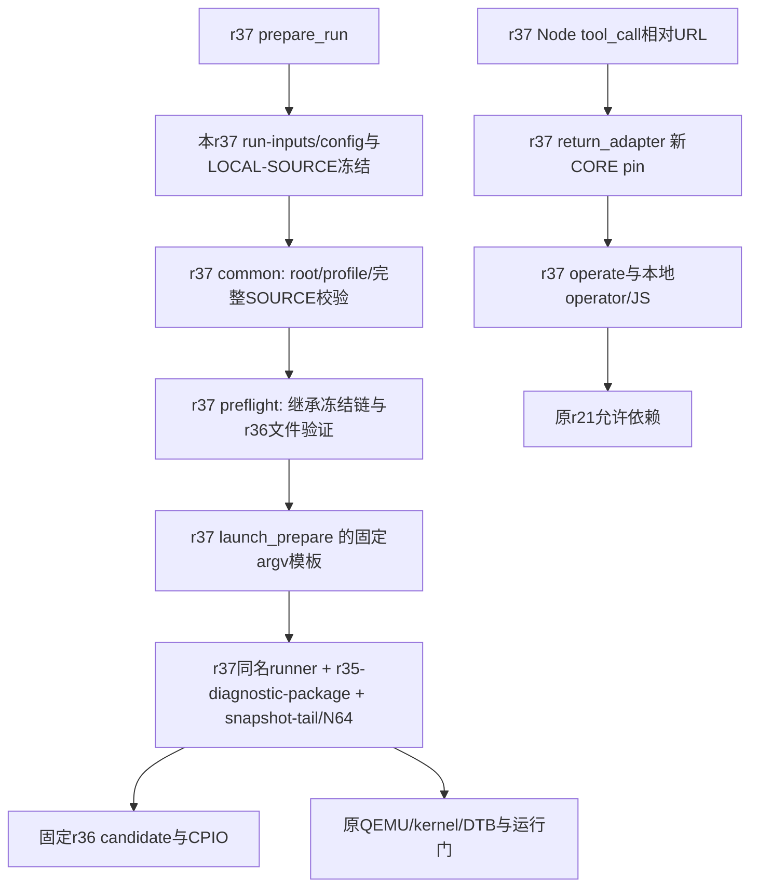

# 固定绑定（运行箭头本轮未执行）

SOURCE冻结42项包含本CORE、return-tools及新selector；CORE37项避免adapter自引用。prepare在新run写完整SOURCE映射，common/adapter必须精确相等，不能接受仍指向旧r30的配置或不完整LOCAL映射。

实际新runner的24个项目模块路径和hash见ALLOWED-IMPORT-BINDING.json：5个关键模块（selector、web、ring、log、startup observation）来自本r37，其余允许的原依赖来自已冻结r21；原source40、delivery145和平台检查完整保留。Node实际导入的adapter是本r37/return-tools/return_adapter.py，OPERATE_SHA仍是未改动operate的原摘要，CORE pin精确更新。

原r30只作为只读源/对比输入，未调用其main。r36只引用不复制，固定CPIO与DTB按原加载地址使用，包manifest历史状态不重写。正常真实run的VM产物目录仍由原runner创建在TRY/runs；本轮没有执行该分支。
