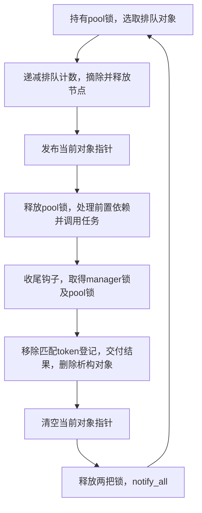

# FX3 工作线程发布、收尾与退出观察

本阶段把上阶段的独立对象槽绑定到了原厂工作线程。正常路径中，**发布当前对象在任务调用之前，清空当前对象在结果交付和删除析构之后**。原指令片段对照通过；实际线程、同步、任务、析构、通知、卸载、刷写和救砖均未运行。

## 原厂绑定与正常路径

固定来源为官方7.02提取的 `appFw.so`，SHA256为 `545c5053a74e04ffbf2bbaaf80f558092dd545ed2298b2395ca547dbba58290f`。内部任务类型113（0x71）对应 `sequence_get_media_remain`、pool0；它不是remote格式113或PTP属性编号。

全局manager在0x9680760。构造函数0x2d03fa0按0x90步长初始化29个pool；原启动函数0x2bd17a4给每个pool准备 `manager+0x310+pool*0x90` 参数块，并把GOT0x47a9c38中的0x2bd77b8作为入口交给0x2f71d6c。后者的原断言名称明确是 `lib::create_thread`。本阶段仅核对传参，未调用它。

入口0x2bd77b8从参数块取出manager，转到0x2bd7604。工作线程的 `参数块+0x88` 正是上阶段查找/wait使用的 `pool+0x78` 当前对象槽，pool基址为 `manager+0x320+pool*0x90`。

下图是原代码正常非空任务分支的静态顺序，箭头之间包含本阶段没有执行的原生操作，不能读作完整仿真通过：



| 原位置 | 证据与边界 |
|---|---|
| 0x2bd7688–0x2bd76a0 | 选取对象、递减计数；停在原列表摘除之前。计数已变，当前对象还未发布，中间态仍在pool锁内 |
| 0x2bd76c4 | 把选取对象写入参数块+0x88，即pool+0x78；随后释放pool锁 |
| 0x2bd76f8 | 通过对象虚表+0x10调用；实际剩余时间对象指向0x2baf850 |
| 0x2bd7718、0x2bd7724 | 收尾分别取得manager+0x2b90及pool+0x18的锁；不是model_lock逻辑所有权 |
| 0x2bd7728–0x2bd7754 | 遍历manager+0x2c60登记链，按对象token选择移除，再调用结果交付帮助函数0x2bd1ecc |
| 0x2bd7764 | 虚表+0x8删除析构；该类实际目标为0x2bb03a4 |
| 0x2bd7768 | 析构返回后才清空当前对象槽 |
| 0x2bd7784 | 两个解锁帮助函数返回后调用manager+0x2bc0的notify_all；随后继续工作循环 |

结果交付帮助函数包含原 `pthread_once`、future错误和futex通知入口。完整结果交付、登记节点移除、依赖任务、时间统计钩子和异常路径没有执行，因此“任务body已返回”或“token登记已移除”都不能代替收尾完成。

## 片段对照结果

21个原指令用例覆盖：3个pool启动传参、2个入口传参、3种队列长度的选取、2次发布、2次任务虚调用分派、3种token登记查找、2次删除析构分派、3种待处理队列的清槽、1次通知参数准备。虚调用分派停在真实函数入口，任务和析构body没有运行。

每个阶段使用独立、明确的合成前提。列表摘除/释放、任务执行、结果交付及析构之间的缺口没有用返回值或输出stub补齐。清槽片段以“此前原析构已经返回”为前提，旧对象内存填充毒值；原片段只清槽，不解引用已结束生命周期的对象。它不证明真实析构成功。

另将片段产生的合成内存复制到新的受限客体，以原hash-set和单pool wait谓词做14个只读对照：

| 合成状态 | 空豁免集合下的原谓词 |
|---|---|
| 对象已发布、排队列表为空 | 需要等待 |
| 任务调用/删除析构入口之前，当前对象仍发布 | 需要等待 |
| 已进入登记/结果收尾阶段，当前对象仍发布 | 需要等待 |
| 当前槽清空、队列为空 | 此pool放行 |
| 当前槽清空、仍有1或3个排队对象 | 需要等待 |

发布后另测集合包含类型113的情形，原谓词会放行；继续确认该集合不能解释成“要等待退出的类型”。这些观察从假定已持有pool锁的位置开始，未取得活体锁，也没有完整wait返回。

完整工作函数入口另作负例，执行到原互斥锁入口0x16ed554就停止。通知片段停在原notify_all PLT，未制造唤醒结果。所有用例只运行原指令，没有新增补丁代码或输出适配器。

## 对安全退出流程的影响

退出观察至少要在正确同步条件下同时检查当前对象和排队对象。不能在没有同步的情况下拼接计数和指针样本；原取出阶段就存在计数变化而当前对象尚未发布的中间态。

还必须先封闭会生成实验profile的新入口。线程在通知后立即回到循环，清槽或一次通知都不阻止它取得新任务；当前槽为空也只说明对应pool在受保护观察时刻的状态。其它pool、主录设置、局部输入包、缓存捕获、实际编码器和模块调用点仍需分别覆盖，不能把剩余时间pool的条件当成全应用空闲。

C++工作草案说明，notify_all用于唤醒等待者；wait会重新取得锁，也允许虚假唤醒，谓词仍需复查。[条件变量原文](https://eel.is/c++draft/thread.condition.condvar)（2026-10-25核对）。同一mutex的unlock/后续lock提供同步关系。[互斥锁原文](https://eel.is/c++draft/thread.mutex.requirements)（同日核对）。这些通用约束有助于解释原控制流，不代替Sony实际运行库、竞争、异常和生命周期验收。

后续离线工作应继续追踪真实入队入口、等待期间的模型所有权交接和配置身份复核。实际允许撤除消费者之前，仍缺少统一激活代次、完整禁止入队机制、原生等待/在途清理、受限恢复器和原字节回读。硬件MAIN成片、音画同步、长录/温度、WBI/冷启动、同机健康备份及独立救援入口保持未完成。

## 重现与证据

```sh
PYTHONDONTWRITEBYTECODE=1 work/sony-firmware-20261024/stage4-windows-collab/mac-verification/.venv/bin/python work/sony-firmware-20261024/stage20-worker-lifecycle/worker_lifecycle.py --output work/sony-firmware-20261024/stage20-worker-lifecycle/new-run
```

输出目录必须不存在；写入前验证目标卷，原件及依赖前后哈希一致。上阶段封存文件已逐项验证，没有重跑已通过的同一套CPU用例，也没有把协调者审阅写成独立复现。

- [摘要](run-20261025/summary.json) · [原指令及完整结果](run-20261025/worker-lifecycle-results.json) · [来源收据](run-20261025/source-receipt.json)
- [阶段前目标](goal-status-before.json) · [阶段后目标](goal-status-after.json) · [持续目标](../GOAL_STATUS.json) · [协调复核](coordinator-observations.json)

UU恢复由用户稍后通知；本阶段未尝试重连、传输或发送Windows任务。相机权限仍仅Windows缓存PnP，未打开相机/磁盘主动接口、认证、切模式、装驱动、读取机身/卡文件、上传模块、执行WBI或刷写。无固件payload或可刷入补丁文件导出。
